The **Dacia Spring Electric (27.4kWh) / Renault K-ZE (26.8kWh**) are both vehicles on the **CMFA-EV platform**. 

There are also a few Chinese EVs that share the same CMFA-EV battery platform; all the following models are compatible with the Battery-Emulator integration:

* Dacia Spring Electric (2021–present)
* Renault City K-ZE (2019–present)
* Dongfeng Aeolus EX1 (2019–2021)
* Dongfeng Fengxing T1 (2019–2021)
* Dongfeng Fengguang E1 (2019–2024)
* Dongfeng Nano Box (2022–2024)
* Venucia e30 (2019–2023)

### Note on model year
Some 2024+ batteries seem to not respond to CAN. Investigation ongoing!

2024+ can be identified with an additional **"Pressure Sensor"** near the HV/LV connector.

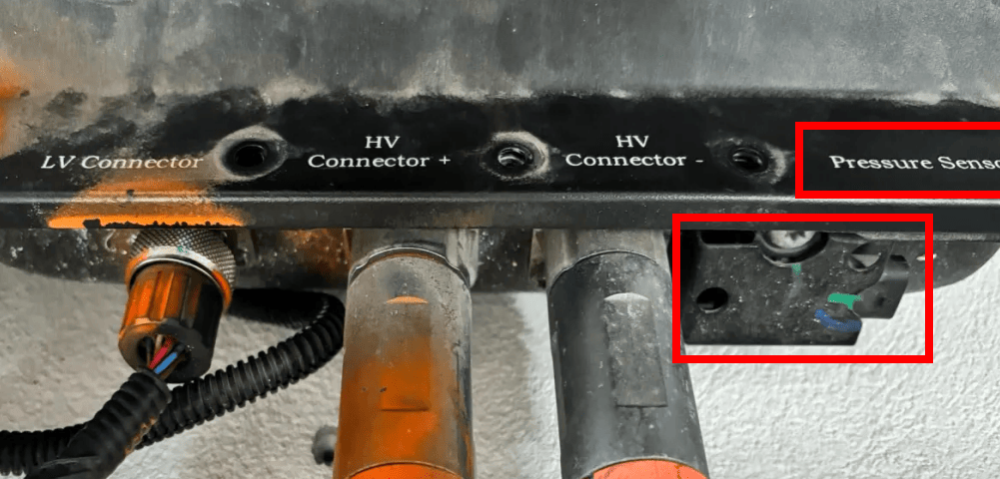

### General info

These batteries have 72 cells in series, resulting in an operating voltage of approximately 216-302 VDC. Make sure [the inverter](../inverter/index.md#compatible-inverters-list) you are planning to use is compatible with this voltage range!

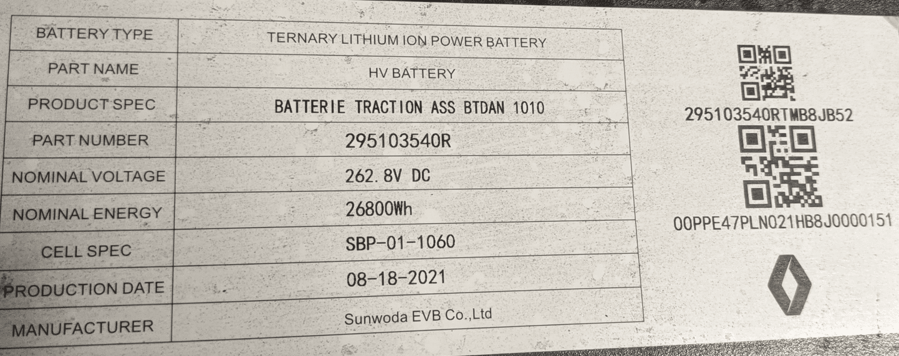

### Testing the battery
In order to read the information from the BMS, you need:

- [LiLyGo T-2CAN](https://dalathegreat.github.io/Battery-Emulator-Wiki/hardware/lilygo_t_2can/) or [Waveshare ESP32-S3-RS485-CAN](https://dalathegreat.github.io/Battery-Emulator-Wiki/hardware/waveshare_esp32_s3_rs485_can/) with Battery Emulator installed and configured for this battery (CMFA Platform) and **NO inverter**.
- 12V source for the board and battery (it can be a Gel battery, UPS, 12V adapter, etc)
- Low Voltage battery Connector with those wires connected: 12V, GND, CAN-L and CAN-H (see the [connections](../images/dacia-spring-renault-k-ze-24.png))

Look for SoC, SoH, and Cell Delta (low is better); see [this example](../images/Spring_be_test.jpeg).

### Shopping list
Here is a detailed [shopping list](https://docs.google.com/spreadsheets/d/14ghFL5mUg0hlUOsraOJc9BExlsMp5ClRRITRSQVLfkA/htmlview#gid=1550632359) for this battery implementation.

## Software configuration
For this battery type, use the option called **"CMFA platform, 27kWh battery"** under the "Battery Protocol" section.

See [Fronius Gen24 settings](../images/Full_Spring_Conf.jpg)

## Battery module - BMS pin diagram
The BMS reads the cell voltage from each module, plus one GND and 2 temperature sensors (one per module); they should be in the ~17 kω range.

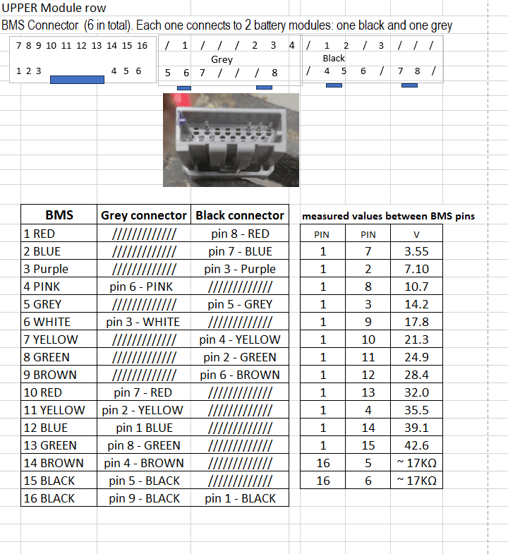

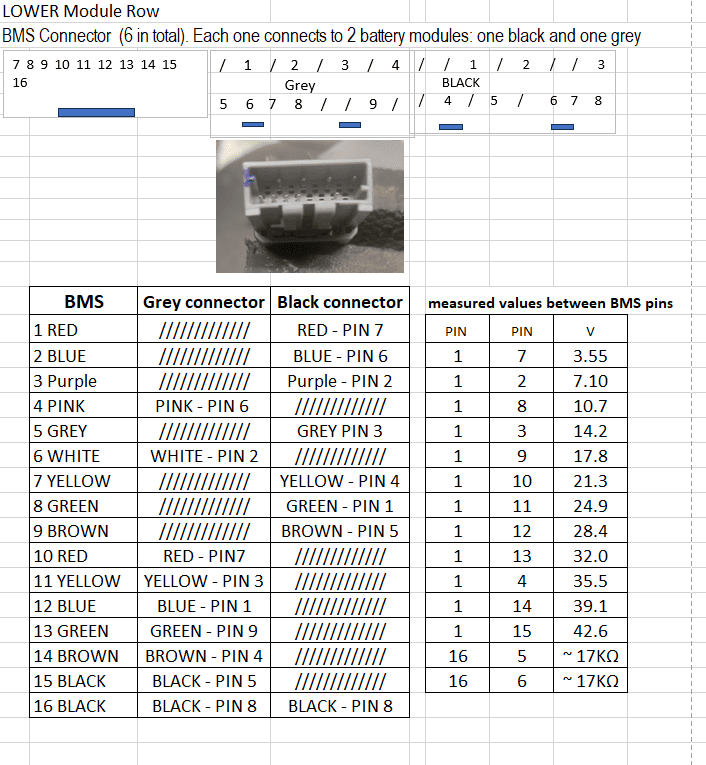

## Wiring diagram, Low Voltage

The battery contains a terminating resistor. 

### Waveshare ESP32-S3-RS485-CAN

[Waveshare ESP32-S3-RS485-CAN](/docs/hardware/waveshare_esp32_s3_rs485_can.md) is the new recommended hardware.

The original drawing file can be found [here](https://drive.google.com/file/d/15E6hzqurfeQikxyK09DTve1eBq5_k_Qm/view?usp=sharing) and can be edited in [draw.io](https://app.diagrams.net/).

### LilyGo T-CAN485

The original drawing file can be found [here](https://drive.google.com/file/d/1YSzWctvrlvYAQNVv0NmDN6hR19TNYFDT/view?usp=sharing) and can be edited in [draw.io](https://app.diagrams.net/).

The LV connector on the battery has the following pinout:

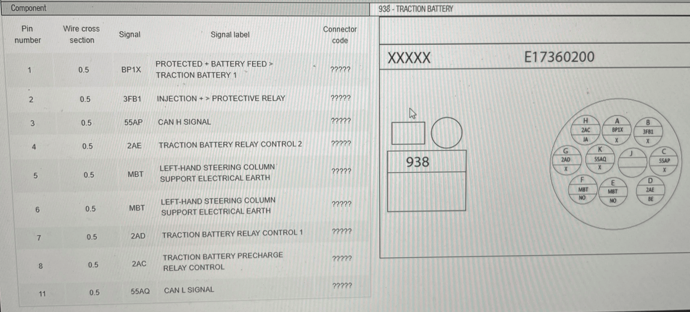

The pin numbering is engraved on the LV connector (PT06A-12-10S)

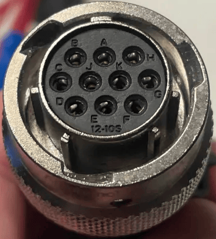

Try to source at least the LV connector; scrapers are happy to cut the cables and usually give them for free.
The LV connector usually goes to scrap with the car.
You can buy LV connector using the PT06A-12-10S from [here](https://www.conrad.com/en/p/amphenol-62in-16a-12-10s-6a-cable-socket-62in-nominal-current-details-7-5-a-pins-10-n-a-739514.html)

If you cannot find an LV connector, you can use the [individual female pins of an OBD2 socket](https://s.click.aliexpress.com/e/_c4n9xqVT).
Don't forget to use insulation (shrink tubing) on the pins and 0.5-0.75 mm copper wires. See [this PDF file](../images/Spring_LV_DIY_pins.pdf).

See this video on [how to crimp the wires](https://www.youtube.com/watch?v=A8TIqNG7Yfk).

Get the HV connector too; it makes things look nicer. 
Search for the HV cable and connector on [eBay](https://www.ebay.com/sch/i.html?_nkw=297A21306R), part#: 297A21306R

There are [two versions of the LV connector](../images/LV_Connector_generations.jpeg), but the **only difference** is the wiring colors.
Connect the battery to the Battery-Emulator according to this diagram:

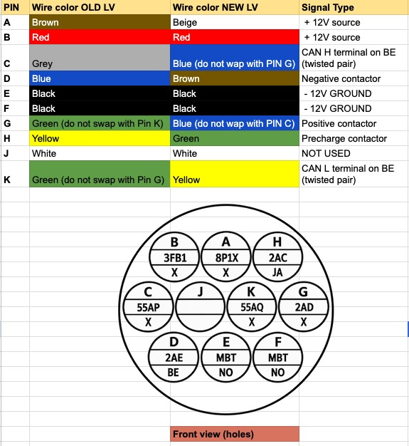

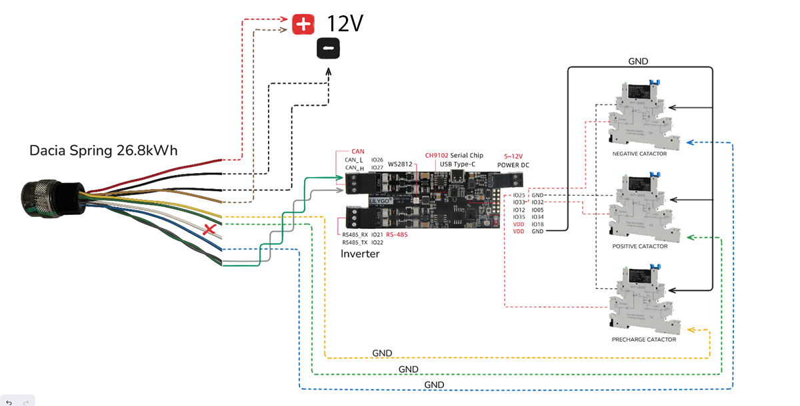

The original drawing file is available [here](../images/Miguel-2026-03-19-2107.excalidraw) and can be edited in Excalidraw (https://excalidraw.com).

12V power info: The precharge+contactors consume 1.5A; the BMS itself uses 0.1A

Use a relay board (NO) (5V or 12V) to apply GND to the pins (pin 2AE / 2AD / 2AC all accept a **GND signal** to be toggled on).

See [4ch SSR on DIN rail **(DC-CN)**](https://s.click.aliexpress.com/e/_olDgyMC)

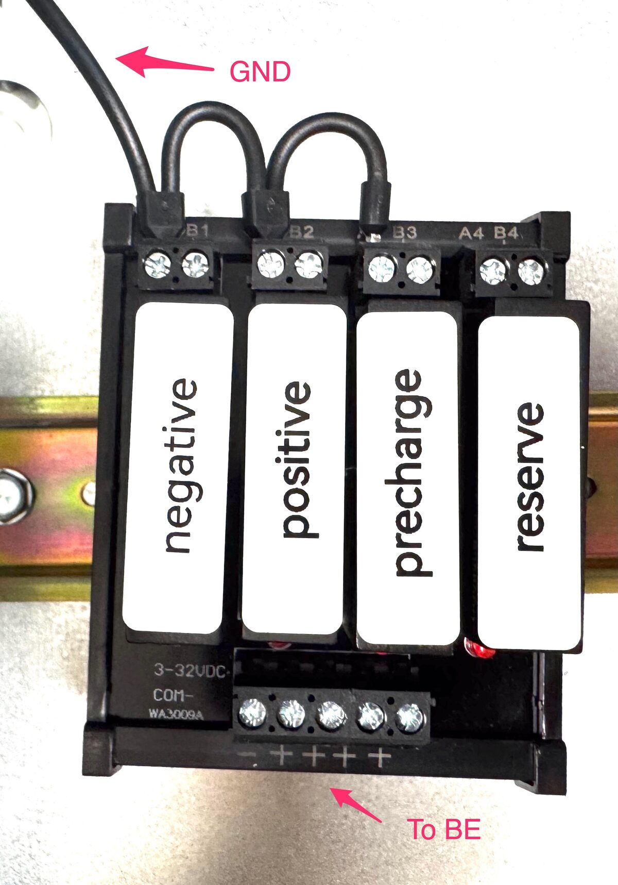

## Wiring, High voltage
The battery has a service disconnect switch:

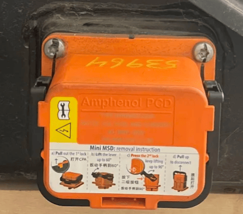

Note that there are two versions of the service disconnect switch. The 2021 model differs from the 2022+ models. So, if you purchase a service disconnect switch, make sure you get the correct model year!

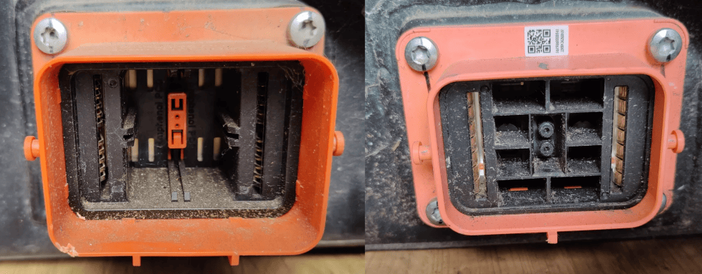

**2022** battery year fuse:

The polarity of the high-voltage outputs is shown here: left is **positive**, Right is **negative**.

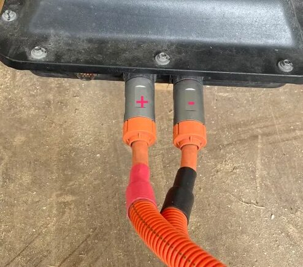

## HV Cable preparation
Beware of the mantle strings (cut them) to avoid touching the copper conductor.
The optional [ferrule](https://www.aliexpress.com/item/1005007192861678.html) for the copper conductor is 35smm
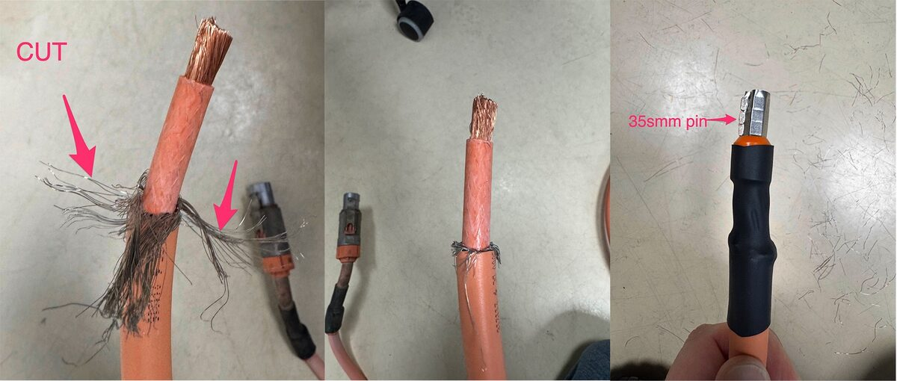

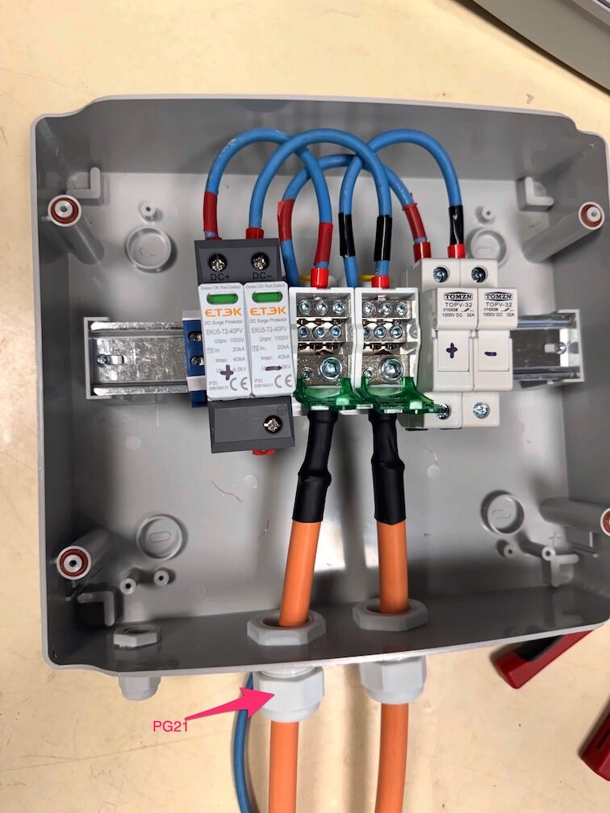

## Configuring the software
Enable the `CMFA platform, 27 kWh battery` option in the software.

Do **NOT** use PWM contactor control.

Spring keeps the HV voltage between 220V (0% SOC) and 296V (100% SOC)
You can adjust the SOC min and max percentages in the emulator settings to keep the battery voltage within that range. Like -5 / 85 with current build (June 2025).

This battery also benefits from automated 30s daily resets, which can be automated with BMS power output. See the [Periodic Reset page](../setup/hardware/periodic_bms_reset.md) for details.

## Fuse sizing:

For fuse sizing, we use the max inverter power / 218V = max fuse size.
ex, for a 5kW inverter: 5000W / 218V = 23A => use a [25A fuse](https://s.click.aliexpress.com/e/_onOPNy8)

* [Fronius Gen24 6-12kW](../inverter/fronius.md) accepts a maximum of 22 A on the battery input, so you will be able to draw from this battery 4.7-6.6kW, depending on voltage (SoC)
* [Fronius Gen24 3-5kW](../inverter/fronius.md) accepts max 12.5A on the battery input.

## Completed builds:
1. DIY wooden support, with space for the fuse underneath
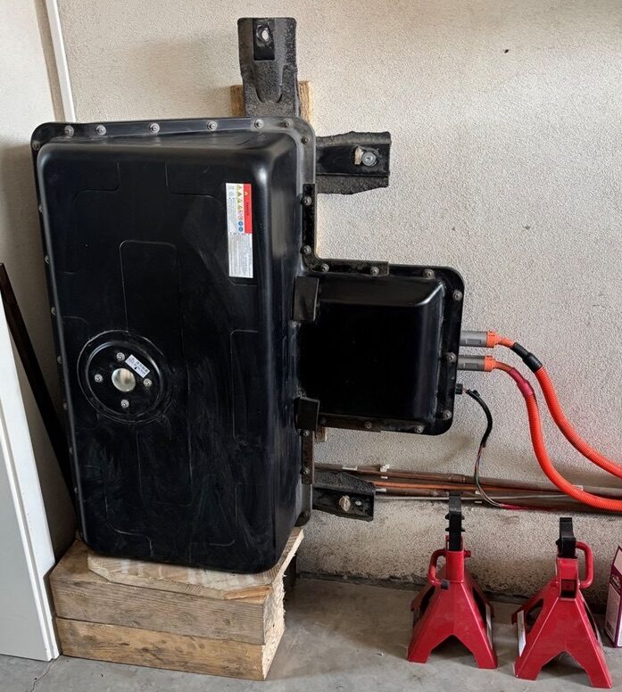

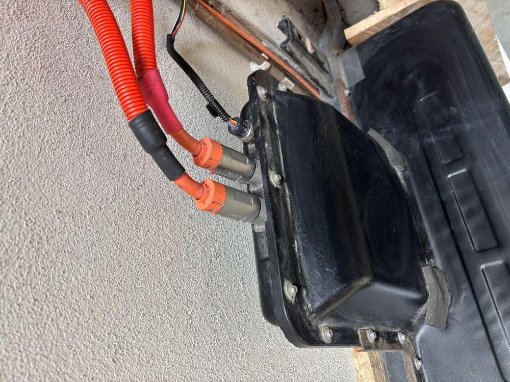

2. Metallic box
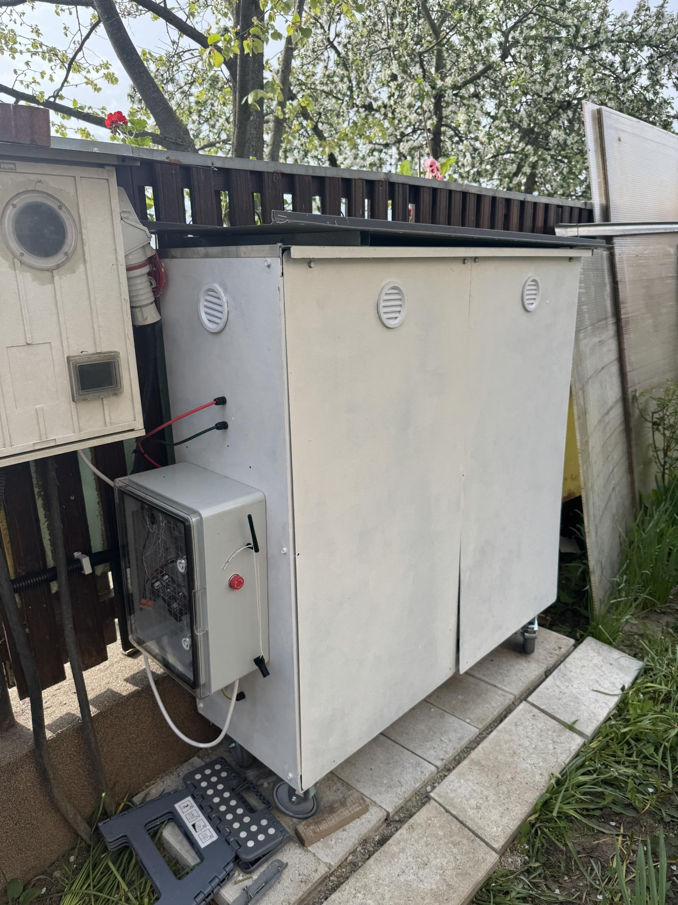
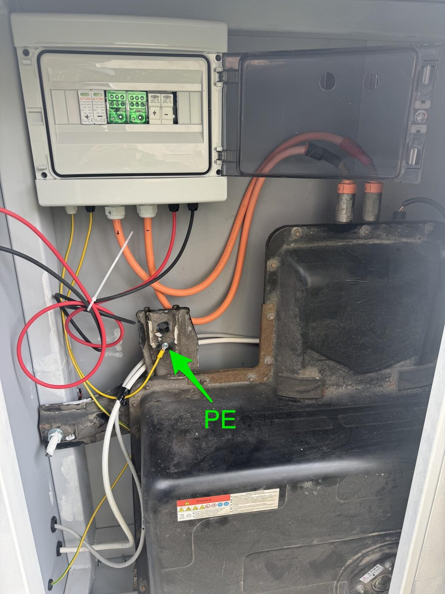

## Note on missing cell voltages
If you don't see all 72 cells on the cell monitor page, the fuses on the cell taps may be damaged.
A telltale sign is that some values become corrupted and the charge current drops to 0. You can fix this by opening the battery and repairing the damaged traces.

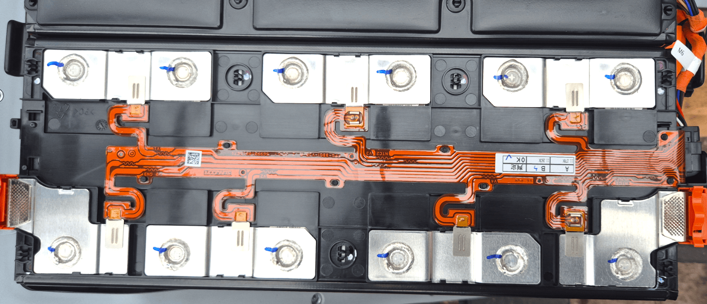

## Inside the battery:

1. One 225A main DC fuse
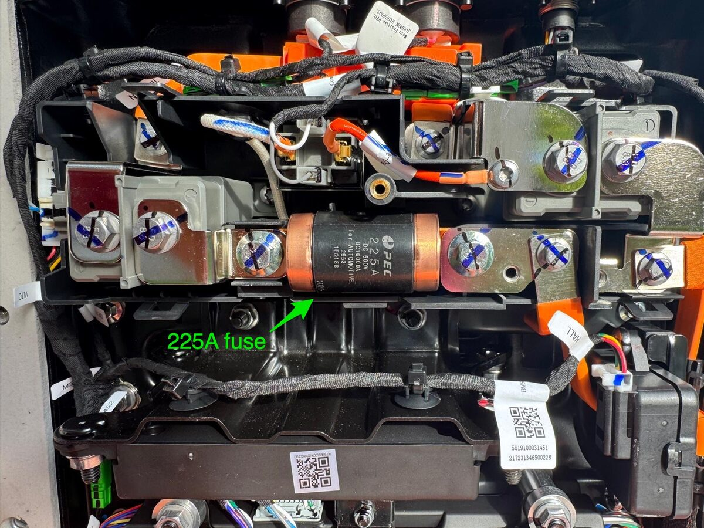

2. One main BMS + 6 slaves BMS
The Master <=> Slave BMSs don't seem software-locked, so you can easily swap the main BMS if it's the same part number (printed on the box).

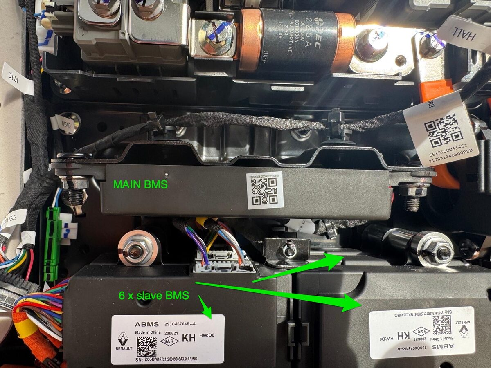

3. Inside look.
The battery case opens very easily. It uses many M7 screws, and no glue seals it.
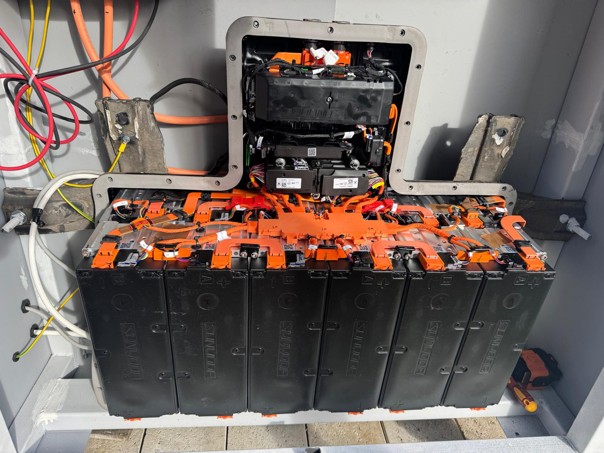
