## Software configuration
For this battery type, use the option named **Nissan LEAF battery** under the **Battery Protocol** setting.

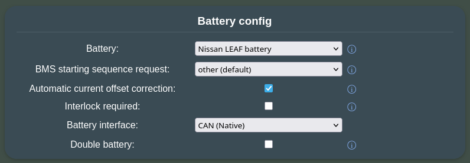

- keep the **Automatic current offset correction** enabled, which will calibrate current measurement skew during open contactors (more info below).
- On a ZE0 (2011-2012 24kWh) battery, you can enable **Interlock required** for extra safety. The system checks that the original high voltage connectors and SDS are properly seated in before you can start.
       - If you enable this setting on an AZE0 or ZE1 (2013-2023) battery, both HV plugs need to be seated (80kW motor and 6kW heater). Thus, for these, it is recommended to **not** use **Interlock required** due to the inconvenience of having to source both HV connectors (and manually insulate one of them). Instead, just block off the unused HV port with a 3D-printed [cover](../setup/hardware/list_of_3d_printable_parts.md#heater-port-cover).
- the **Balancing strategy** setting is **Aggressive** by default. Start with this value if this pack is newly deployed, or experiences high cell voltage deltas (> 150mV). You can start experimenting with the **Conservative** when you have gained some experience on how balancing and degradation perform over time (using some monitoring solution over [MQTT](../setup/software/mqtt.md), like for example [Home Assistant](../setup/software/home_assistant.md), to observe behavior is strongly recommended). Changing this setting requires a BMS reset.

!!! tip "TIP"
    **Balancing strategy** set to **Conservative** avoids overbalancing when your pack is in good shape (small cell voltage delta in your preferred SOC range). The **Aggressive** setting corresponds to the way the battery used to balance when in the car duing driving, **Conservative** is the way it used to balance during AC charging. **Off** corresponds to the balancing strategy that used to be applied during quick charge of the car.

    The setting can be applied individually per pack in [double](../setup/software/battery_2x.md) or [triple](../setup/software/battery_3x.md) battery setups.

## Wiring diagrams 🔌

The following pictures show an example of hooking up a LEAF battery to a [Fronius Gen24 inverter](../inverter/fronius.md). The same diagram can be useful for planning other inverter combinations.

[Waveshare ESP32-S3-RS485-CAN](../hardware/waveshare_esp32_s3_rs485_can.md) is the new recommended hardware.

!!! note "NOTE"
    The LEAF battery requires a 12V supply (**set to 14V**) capable of delivering at least 1.5A.

Remember to seat the service disconnect switch. 

Without this fitted, the battery will not output any voltage when contactors are closed.
This is how the SDS is used [(Youtube)](https://www.youtube.com/watch?v=tbo2Qzdj-Rg).

### High Voltage connection (energy)

The Positive (+) wire is near the data port, and the Negative (-) wire is near the PTC high-voltage port (Aux Max 6kW).

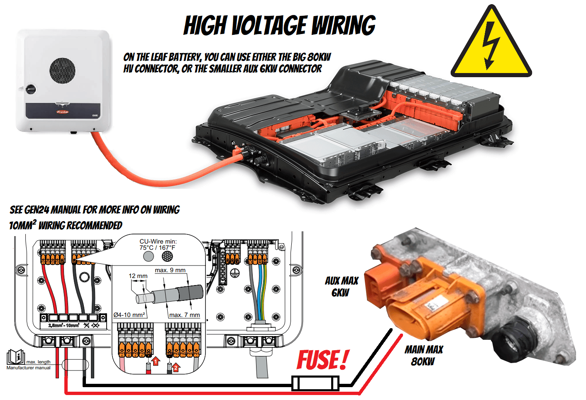

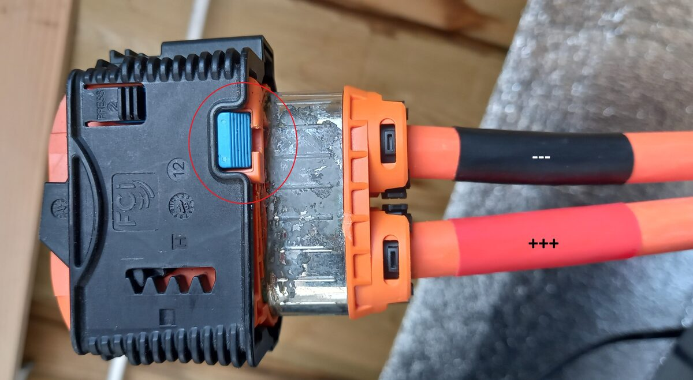
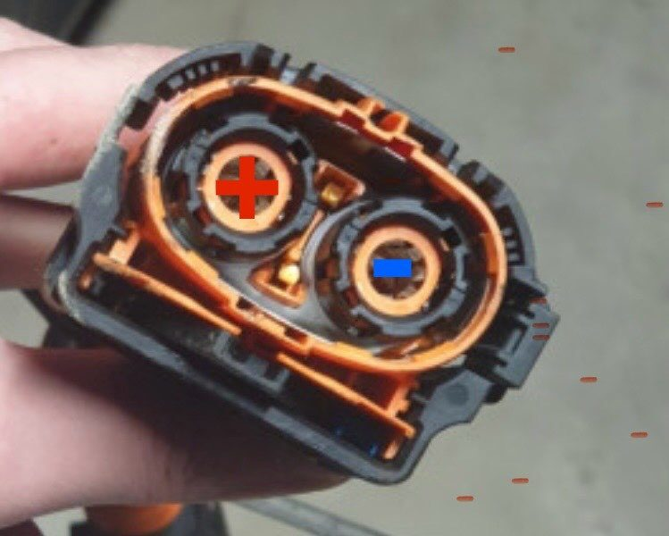

!!! success "TIP"
    Check out our [High Voltage wiring](../setup/hardware/wiring_tips_hv.md) page with examples on how to make the connections safely.

### Low Voltage connection (control and data)

The example diagrams below show how to connect a [LilyGo T‐CAN485](../hardware/lilygo_t_can485.md) or a [Waveshare ESP32-S3-RS485-CAN](../hardware/waveshare_esp32_s3_rs485_can.md) to a Nissan LEAF AZE0/ZE1 pack (with a Yazaki 36-pin connector), using automatic contactor control via solid-state relays, also featuring [periodic BMS reset](../setup/hardware/periodic_bms_reset.md) and an optional [equipment stop](../setup/software/equipment_stop.md) circuit.

#### LilyGo T-CAN485

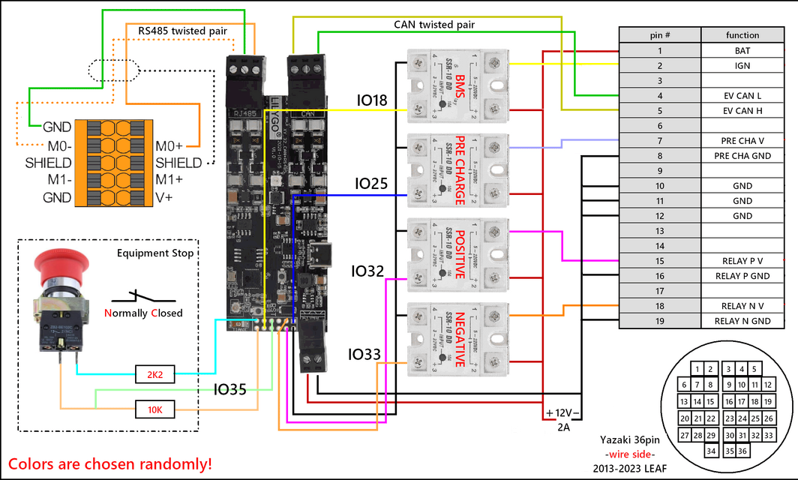

#### Waveshare ESP32-S3-RS485-CAN

The schematics can be found [**here**](../images/Fronius_Nissan_leaf.drawio) and can be edited via [draw.io](https://app.diagrams.net).

Nissan's own documentation uses pin numbering on the 36-pin low-voltage connector, which does not match the molded connector on AZE0/ZE1. The connections on this diagram have been renumbered so that they do. Scroll further down for the pinout of the 22-pin connector for ZE0.

!!! success "TIP"
    Check out our [Low Voltage wiring](../setup/hardware/wiring_tips_lv.md) page on how to make the connections in practice.

#### Automatic control 🤖

Battery Emulator hardware can act on its own and [turn on/off the contactors/precharge resistor](../setup/software/contactor_control_via_gpio_pins.md) when the battery says it is OK, and turn off when it is not OK to proceed. This is done via the 3.3V digital output header that is located on the supported boards.

To enable the feature in the software, enable the **Contactor control via GPIO** option on the Settings page.

{ width="505" height="42" }

To keep things simple and durable, it is recommended to use Solid-State Relays (SSRs). These can be activated directly with 3V from the Emulator GPIOs and control large DC currents. Follow the schematic above to complete the circuit. 

The pin numbers in the picture are used on the LilyGo T-CAN485; check the pinout table for each board to see which pin is designated as the contactor output.

!!! tip "TIP"
    If you use **fast-switching** SSR relays with the Battery-Emulator hardware, you can also enable PWM mode for reduced power consumption. Here are parameters confirmed working with the LEAF contactors+PWM:

Before the contactors turn on, both the inverter and the battery need to give an OK ✅ signal. This can be verified via the web interface:

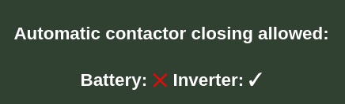

!!! warning "WARNING"
    New hardware requirement for Fronius :warning: Battery voltage is reported to Fronius inverters only after contactors are engaged. **This means that legacy installs using manual A/B/C switches to turn on battery contactors will no longer function with Fronius inverters.** Only automatically controlled  contactors via GPIO will work. This is a new, stricter safety requirement to get the Fronius inverter to start up faster and with fewer errors. The bonus is that GPIO-controlled contactors are inherently safer than manual A/B/C triggering.

## Periodic restart of BMS

The BMS in the Nissan LEAF packs was not originally designed to operate 24/7 under all conditions. Over time, the SOC% will become less accurate, and under certain conditions, even the GIDS (Wh remaining) becomes confused (see [Issue 86](https://github.com/dalathegreat/Battery-Emulator/issues/86)). The **BAT** pin can be under +12V continuously; the **IGN** pin should be the one turned off from time to time (as the wiring diagram above). 

See the [Periodic Reset page](../setup/hardware/periodic_bms_reset.md) for details. 
Set **Periodic BMS reset off time** to **120 seconds** for Nissan LEAF packs. Based on empirical observations, the 30kWh (2013–2017, AZE0) pack benefits most from the **24h** period, together with the **Skip reset for one period if balancing** option enabled. Changing **Balancing strategy** to **Conservative** may improve balancing on packs that are in good shape (small cell voltage delta over the entire SOC range you use).

!!! tip "TIP"
    The LEAF BMS uses *passive* balancing: each of the 96 cells has a small resistor (shunt) that can be switched on to dissipate a small amount of energy as heat, slowly bringing fuller cells down to the level of the lowest cells.
    At the start of a balancing cycle, it measures all cells and flags any cell that is more than a small tolerance above the lowest one.
    While draining, it keeps track of how much it has taken from each flagged cell and switches that cell's shunt off once the count indicates it is close enough to the lowest one.
    So a small difference between cells is normal, and the flagged cells aren't always the ones with the highest voltage at that moment. The target cell delta is around 17mV.

The same cells may stay flagged for many hours (sometimes a day) before draining really starts: the [Cellmonitor](../setup/software/webserver_guide.md#cellmonitor) shows them as cyan bars marked **Pending**, then **Balancing** while the list keeps changing, until it's empty.

A BMS reset discards the progress and restarts the whole process, waiting included — which is why the **Skip reset for one period if balancing** option helps.

## More Battery Info 📜

The **More Battery Info** button at the bottom of the main page opens a window with additional information about the pack. A few notes about the most important ones:

- **+12V BAT level**: the voltage level of the 12V source that you use to power up the pack (at **BAT** and **IGN** inputs). Should not go below 10 V!
- **Insulation**: [insulation resistance](../setup/hardware/insulation_monitoring.md) measured by the BMS. When contactors are closed, this value averages around 100kΩ (may depend on the inverter). When contactors are open, this shows much higher values. Both are normal like this. This value should not be considered; it's the inverter that determines whether there's an insulation problem.
- **Capacity as new**: is the estimated capacity in kWh when the pack was new out of the factory.
- **Actual capacity**: is the degraded capacity in Ah (and multiplied by the pack's nominal voltage in kWh) corresponding to the BMS's health knowledge about the cells.
- **Regen kW**: the charge power the BMS allows right now, as sent in its latest message. The main page's **Max charge power** is based on its 15-second average (see note below).
- **SOH raw**: the raw State-Of-Health (and the average one) reported by the BMS on the CAN bus. The average one is what you'd see in LeafSpy. Both show 100% if the pack has been SOH-reset recently.
- **Hx**: is a Nissan-specific measurement value related to the internal resistance of the pack. Shows 100% if the pack has been SOH-reset recently (see further down below).
- **QC charge count**: the total number of quick (DC/Chademo) charges that have been started while the pack was operating in the car.
- **AC charge count**: the number of AC charges that have been started while in the car. This number increases at each pack boot and BMS reset when **Balancing strategy** is set to **normal charge**.
- **Charge to full count**: the number of charges that resulted in a full battery.
- **Turtle count**: the number of cases when the car has been forced to run into turtle mode, to prevent over-discharging.
- **Automatic current offset**: the current offset measured at every boot and again each time the contactors open (see note below).
- **Lifetime usage histograms**: Each event recorded the temperature at its start and the peak it reached. Peak (the hottest the pack got) drives the heat assessment; start temperature is shown alongside.

!!! success "Capacity information"
    The SOH value you see on Battery Emulator's main page is calculated from **Capacity as new** and **Actual capacity**. It may be slightly different from the (raw) SOH value you'd see in LeafSpy, but it's still a relevant value, even for an SOH-reset pack, which would stay at 100% for a longer period.

A certain discrepancy between total charges and the AC + QC counts is normal — it can occur when charging is interrupted (e.g., by a power cut).

??? quote "Power limit averaging"
    Near full or empty, the LEAF BMS can swing the charge or discharge power it allows between 0 and a few kW every second or two. Passed on as they come, these swings make the inverter chase a moving target, and can raise "Inverter is charging faster than battery is allowing" events. Battery Emulator therefore averages the max charge and max discharge power reported by the BMS over the last 15 seconds (separately for each pack in [double](../setup/software/battery_2x.md) or [triple](../setup/software/battery_3x.md) battery setups). Everything downstream builds on the averaged values: the main page, the inverter, MQTT and ESP-NOW. The averaging is always on and needs no setting. A reduced allowance reaches the inverter gradually, over up to 15 seconds, but if the BMS withdraws an allowance completely for a whole second, it drops to 0 instantly, then climbs back gradually when the allowance returns. The BMS's own fully charged, empty and relay cut flags, as well as Battery Emulator's cell and pack voltage protections, still stop charging or discharging immediately. **Regen kW** on the More Battery Info page keeps showing the raw value from the latest BMS message, for comparison.

??? quote "Automatic current offset"
    Some Leaf battery packs report a small current even when none should flow; in some cases, it reaches a few amperes. This shows up as phantom charging or discharging, and skews the power and SOC figures passed to the inverter. With Automatic current offset correction, enabled by default under Battery config, Battery-Emulator measures this error itself. Whenever a pack's contactors are open, any current the BMS reports can only be sensor offset. After a short settling time, those readings are averaged over the last 10 seconds and subtracted from that pack's current thereafter. The offset is measured at every boot and again each time the contactors open. It is kept unchanged while they are closed, including during a periodic BMS reset. A second or third pack that stays disconnected, for example because its voltage differs too much from the other packs, keeps updating its offset. Battery Emulator can only tell that contactors are open when it drives them itself, so this needs **Contactor control via GPIO** enabled, plus **2ⁿᵈ / 3ʳᵈ battery contactor control via GPIO** in [double](../setup/software/battery_2x.md) or [triple](../setup/software/battery_3x.md) battery setups. Each pack is measured separately, using its own contactors. The value found for each pack is shown as **Automatic current offset** at the bottom of the Status panel on the More Battery Info page. "Unknown" means the pack has not yet been measured, for example, because its contactors are not controlled by Battery-Emulator. The setting takes effect after a reboot. Put simply, to recalibrate, just reboot Battery Emulator.

When the BMS limits the pack's output power, the [log](../setup/software/webserver_guide.md#log) names the reason each time it changes, for example `Battery output power limit reason: 3, high temperature`. The reasons are 1 low cell voltage, 2 fault or other, 3 high temperature (hottest sensor at or above 51°C), 4 low temperature (coldest sensor below -10°C), and 0 when the limit is lifted. ZE1 (2018+) packs show the number only, as their codes are not decoded yet.

!!! tip "TIP"
    The LEAF battery is fully charged at 92-96% SOC. Use the [Rescale SOC](../setup/software/webserver_guide.md#rescale-soc) function to get a nicer-looking 100% curve! However, Nissan specifically advises against habitually charging to 100%, which adds wear; thus, for a longer lifetime, you should set **SOC max percentage** to **80** long term (during the summer, when the pack would charge to 100% quickly and then stay full almost all day).

## Part numbers for Nissan LEAF batteries

If your battery is missing any wires/disconnect switches, here are the OEM part numbers and purchase links. Do note that it might be cheaper to source from your local scrapyard!

|  Product |  Purchase Link |
| :--------: | :---------: |
| Service disconnect switch (2011-2012) 2971C13NA0B |  [Ebay](https://www.ebay.com/sch/i.html?_nkw=fuse+2971C13NA0B)   |
| Service disconnect switch (2013-2023) 297C1-3NF0A |  [Ebay](https://www.ebay.com/sch/i.html?_nkw=nissan+297C1-3NF0A&_sacat=0)   |
| 22pin battery connector (2011-2012) Yazaki 7283-8750-30 |  [AliExpress](https://www.aliexpress.com/item/1005003344398420.html)   |
| 36pin battery connector (2013-2023) Yazaki 7287-1065-30 |  [AliExpress](https://www.aliexpress.com/item/1005004180391674.html)   |
| Precrimped 22/36 connectors | [AliExpress](https://www.aliexpress.com/item/1005005815234149.html)   |
| High voltage connector 80kW 297A6-5SH1A |  [Ebay](https://www.ebay.com/sch/i.html?_from=R40&_nkw=297A65SH1A&_sacat=0)   |
| High voltage connector 80kW 297A22581R ZOE, also works |  [Ebay](https://www.ebay.com/sch/i.html?_from=R40&_nkw=297A22581R&_sacat=0)   |
| High voltage 80kW cable 297A21061R from ZOE41 (both ends have the good connector type) |  [Ebay](https://www.ebay.com/sch/i.html?_from=R40&_nkw=297A21061R&_sacat=0)   |
| 4ch SSR on DIN rail. Make sure you get the DC-CN version! | [AliExpress](https://aliexpress.com/item/1005007825084745.html) |

!!! tip "TIP"
    All e-NV200 packs are technically AZE0 / ZE1, so 2013+ parts fit them!

A [**spreadsheet**](https://docs.google.com/spreadsheets/d/14ghFL5mUg0hlUOsraOJc9BExlsMp5ClRRITRSQVLfkA/edit?gid=0#gid=0) with parts and links for a Nissan 40kwh battery and 8kW inverter (30A fuses).

!!! tip "TIP"
    The current sensor in the LEAF battery is not very precise, especially at low currents. For good measurements, especially in [double](../setup/software/battery_2x.md)/[triple](../setup/software/battery_3x.md) setups, or for accurate [charge power tapering](../setup/software/webserver_guide.md#inverter-config), you can use an external current sensor on the DC wire heading toward the inverter: [QNHCK2-16 DC clamp](../setup/hardware/shunt_qnhck2_16.md).

### Incompatible cables

When searching on eBay, you may come across other cables in the Zoe that use a connector that is similar in appearance but is much smaller:

* Zoe HV Wiring Harness - PN: 240419193R
* Zoe HV Engine Bay Wiring Harness - PN: 240413370R
* 297A6 3NA0A does not fit; you have to cut a part of it to use the pins.

These will *not* connect to the Leaf battery terminals.

### Alternative HV connectors 

The original part number for the Nissan Leaf battery is 297A65SH1A, but a cheaper alternative for the battery HV connector can be found in scrapyards. Renault Zoe or Kangoo Batteries use the same connector as the Leaf battery. 297A22581R is the part number for both cars.

The connector used is an [Aptiv HV RCS 800](https://www.ttieurope.com/content/dam/tti-europe/manufacturers/aptiv/doc/aptiv-hv-rcs-800-automotive-connectors-datasheet-specifications.pdf).

## Control wiring specifics

The battery contactors draw 0.4 A each at 12 V. **0.5 mm²** (AWG 22) is enough cable cross-section for the required current. 

### If you pin the connector yourself

The Yazaki 22/36-pin connectors are designed with a 2.1mm hole to accommodate the cable and include an elastic ring for waterproof sealing. The normal cable of the above cross-section has protective insulation that is too thick (usually 2.1mm in external diameter) to be used with the waterproof seals. You may want to choose an automotive cable that follows the reduced rubber cable standard (FLRY-A or B, ISO 6722) and has an outside diameter no thicker than 1.5/1.7mm (preferably 1.5 mm). Need at least 0.7/1mm thick cable (e.g., cable + wrap) to allow correct waterproofing; e.g., no Ethernet cable can be used because it's too thin. 

BTW, it's not strictly necessary for a cable to be automotive-grade if it has a sufficient copper cross-sectional area (0.5 mm²) and an outer diameter of ~1.5 mm. 

!!! note "NOTE"
    Ensure the pins go all the way to the bottom and the pin is seated properly with a "tick". If they are inserted incorrectly (not far enough, "wonky") then you won't have a proper connection.
    
Of course, if you install the battery indoors, you can omit the sealing rings and have a wider range of wire choices. You can use a 3D-printed [cover](../setup/hardware/list_of_3d_printable_parts.md#lv-connector-cover-and-fixation-ring) to protect the connector from falling debris.

Pinout for the Yazaki 22-pin connector, to be used with ZE0 packs:

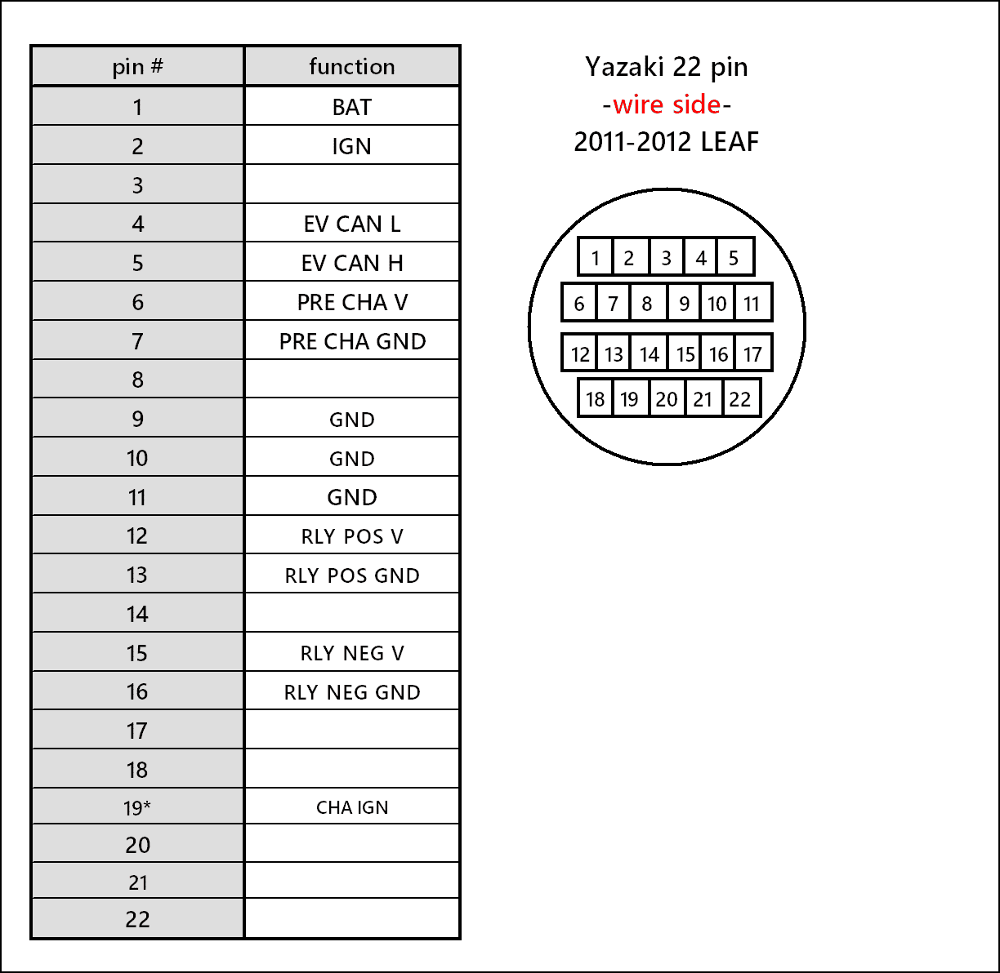

Here is a nice example of a completed 22-pin 2011-2012 cable:

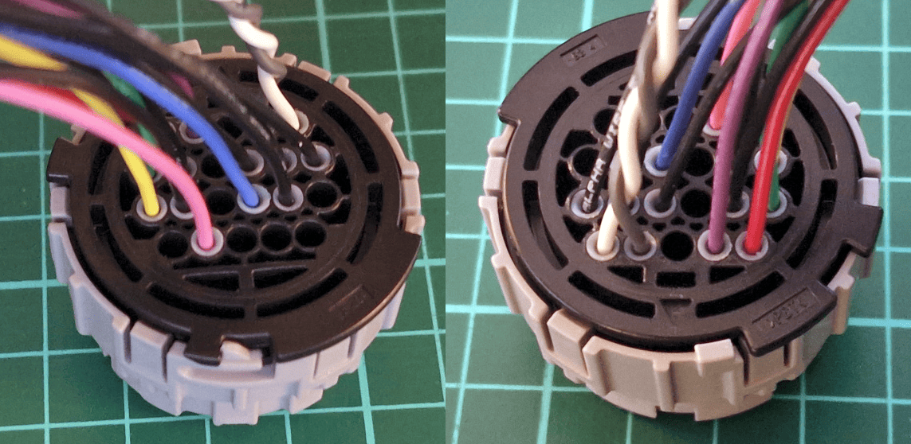

Crimping a 36pin connector:

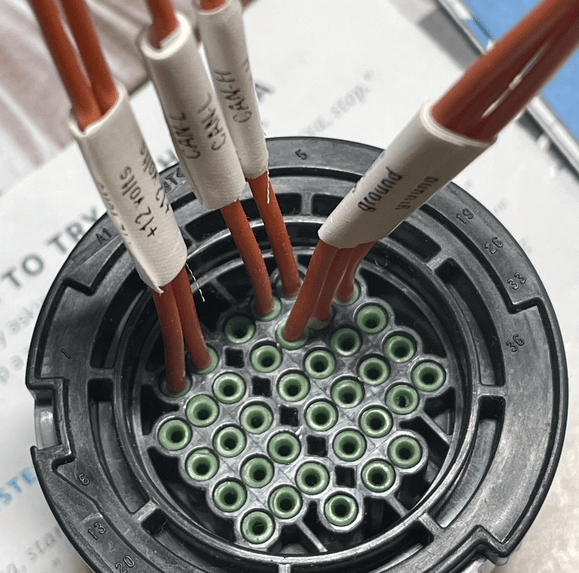

## 3D-printable parts

You can print your own safety cover for the **unused heater port**, a dust protector for the **LV connector** and a fixation ring, even a complete **Service Disconnect Switch** or even your own **HV Connector**. Check out the [3D‐printable parts page](../setup/hardware/list_of_3d_printable_parts.md#nissan-leaf).

## Notes on stuck SOH ❤️‍🩹

!!! warning "NOTE"
    **SOH** and **Hx** reported by the BMS do not accurately reflect the real degradation of the cells during stationary storage over time. 

??? quote "DETAILS"
    Reverse engineering of the LEAF battery controller (LBC) firmware shows that it updates its SOH only through two built-in estimators, and both are tuned for driving, not for stationary storage:
    
    - The capacity-based estimator needs a measured discharge from a rested, nearly full pack (about 88 % or more) to a rested, nearly empty one (about 25 % or less), and it throws the measurement away whenever the averaged pack current stays below about 20 A for 16 minutes.
    - The resistance-based estimator needs regen-like events, at least 10 A of charge fading into at least 10 A of discharge within a second or two, at 40–95 % SOC and 10–50 °C, and it only runs while the balancing strategy is set to Aggressive.

    An EV battery repurposed for stationary storage mostly runs well below 20 A, and in double or triple setups the inverter current is split between the packs, so each pack sees only a half or a third of it and these thresholds are practically never reached. Even a newly learned value only takes effect when the LBC restarts, so without a periodic BMS reset it would not be published either.
    
    In practice the SOH, together with the capacity and remaining-energy figures the LBC derives from it, stays at the value it had when the pack left the car, and this is not a fault of the pack or of Battery Emulator. A degradation reset only sets it back to 100 % without measuring anything, so a real health check needs an external capacity measurement, for example a full charge and discharge counted with a shunt, which is out of Battery Emulator's scope and possibilities.

The 2016-2017 30kWh LEAF battery had a software bug in the BMS that caused the reported kWh to be incorrect and the state of health % to drop too quickly. If you have one of these batteries and it shows SOH below 50%, it might be affected. The Battery-Emulator can perform a degradation reset and bring the **Hx** and **SOH** percentages reported by the BMS back up to 100%. This can be accessed from the Webserver, via the "More battery info" page. By pressing "Reset degradation data", the clear is performed. 

This will not give you any more battery capacity, though if you've swapped a bad cell with a good cell a reset is required to make use of the new capacity. Actual capacity reported in **Ah** is not affected by the reset.

!!! warning "NOTE"
    If you perform the degradation reset, certain **SOH** levels and **Hx** will show as 100% and stay there. However, this will widen the SOC range you can use your battery in, possibly giving you a few kWh of usable energy back, but you'll have to carefully set your limits manually, as described further down below.

!!! info "IMPORTANT"
    The degradation reset only works on 2011-2017 (ZE0/AZE0) batteries. 

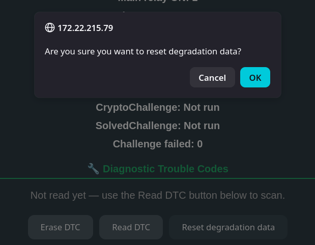

### Performing the reset 

--8<-- "snippets/small_flash.md"

To perform a proper SOH% reset, [that sticks between reboots](https://github.com/dalathegreat/Battery-Emulator/issues/900#issuecomment-3482162856), choose how to perform the following steps:

#### At the location

- Open contactors
- Reset battery degradation via the More Battery Info page
- Disconnect CAN cable from the battery
- Keep BMS **BAT** power ON, only remove **IGN** 12V power
- Wait 3 minutes
- Reconnect CAN cables
- Restore 12V to **IGN**
- Close contactors
- Reboot Battery Emulator

#### Remotely

!!! note "NOTE"
    This can only be done remotely if only **IGN** is cut by BMS Reset and the battery is the only device on the CAN bus.
    
- Set **Periodic BMS reset off time** to 180 s
- Open contactors
- Reset battery degradation via the More Battery Info page
- At **Perform a BMS reset now** press **Start** and wait for the 180s to pass (watch Battery Emulator main page)
- Close contactors
- Reboot Battery Emulator

After these steps, the CAN-reported **SOH** and **Hx** reset to 100% becomes persistent. Actual capacity in **Ah** is not affected by the reset.

### Set your own, real limits 

Note that after you reset the SOH to 100%, the BMS will allow charging and discharging the cells, likely beyond limits that are safe for long-term use, with respect to the cells' longevity. In stationary use, the battery charges and discharges much more slowly and in a different pattern than when used in a car.

You can set up [Home Assistant](../setup/software/home_assistant.md), which lets you track cell voltages and delta over the long term, to be able to investigate the behavior. 

To see some results, follow these steps after you do the reset (in normal ambient conditions; avoid extreme cold or hot periods):

- Disable [Rescale SOC](../setup/software/webserver_guide.md#rescale-soc) if you have it set
- Let the battery discharge to empty
- Let the battery charge to full
- Let the battery discharge to empty again
- Watch how the values of **Cell Voltage Delta** and **SOC (real)** change over time as approaching full and empty

For example:
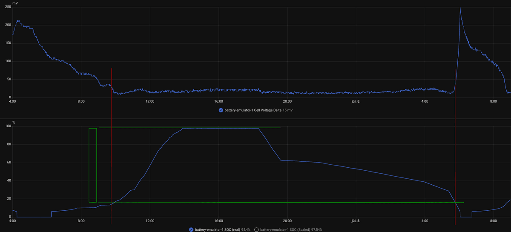{ width="2200" height="1000" }

!!! tip "TIP"
    The BMS will prevent damage to the cells during discharge to empty and charge to full. Battery Emulator will show these events as `Battery is completely discharged` and `Battery is fully charged`. You'll likely see `Large cell voltage deviation! Check balancing of cells` too. The goal is to find the thresholds you can manually set between which the battery can operate without regularly encountering these.

Try to find the widest time window of **Cell Voltage Delta** where the value changes the least — that's the most comfortable and safest "zone" for the cells to operate. Look at the **SOH** graph over the same time period — that should give you the minimum and maximum percentage of SOC rescaling you can set in Battery Emulator to prevent the battery from entering the high cell voltage delta zone. Take into account the absolute minimum SOC value your inverter is willing to go until (eg. Fronius allows discharging to 5% only, doesn't go below), you can reduce min SOC rescale about by that amount. 

In the example above, the top graph establishes the red lines, which show the comfortable area of **Cell Voltage Delta**. The green lines show where the SOC curve intersects the red lines: this gives the min and max SOC rescale values for a safe zone. (Note the slight hysteresis between charge and discharge; take the highest value for safety.

This way, you'll still be in the safe zone with your battery, but you'll likely be able to use a higher capacity than the original SOH allowed in the BMS before the reset. Re-evaluate this graph periodically, every 3 months (no need to do full charge-discharge so often; just keep your eye on **Cell Voltage Delta** and **SOC (real)** relation on normal usage)

## Physical size 📏

The Leaf battery packs (24/30/40kWh) are all the same physical size. The 62kWh battery, however, is 40mm taller.

- 24kWh (2011–2012, ZE0) = 277kg (601lb) 1547.0 (L) × 1188.0 (W) × 264.0 (H) mm
- 30kWh (2013–2017, AZE0) = 294kg (648lb) 1547.0 (L) × 1188.0 (W) × 264.0 (H) mm
- 40kWh (2018–2023, ZE1) = 303kg (668lb) 1547.0 (L) × 1188.0 (W) × 264.0 (H) mm
- 62kWh (2018–2023, ZE1) = 410kg (903lb) 1547.0 (L) × 1188.0 (W) × 304.0 (H) mm

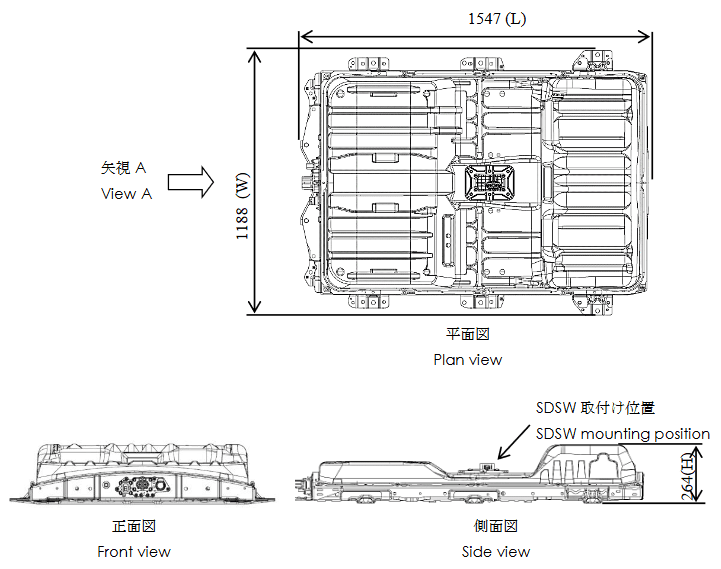

The e-NV200 battery pack is 1578 (L) x 1102 (W) x 266 (H) mm and is packaged differently from the Leaf packs (active cooling and service disconnect at the front instead of the middle).

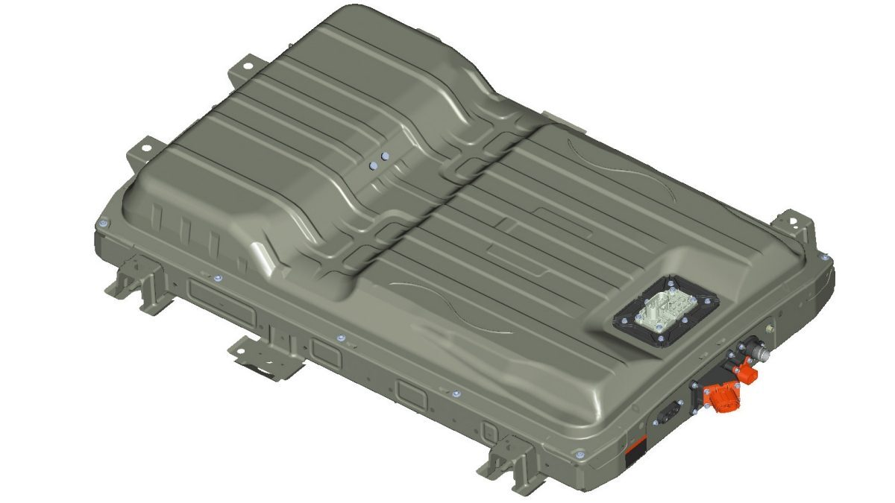

## Test before you buy 🔍

You can test a Leaf pack on-site before you buy it by making a portable cable with a Yazaki connector and bringing a 12V power source (AGM, UPS, 3x18650 in series, etc.). 

If you have a spare, compatible ESP32 board with a CAN connector, you can use the Battery Emulator **with no inverter configured** to start communicating with the pack; open **Cell monitor** or **More Battery Info** to check health and lifetime usage. 

Worth making a rig with SSRs and enabling **Contactor control via GPIO** / **Periodic BMS reset** settings, so the contactors would close to verify with a multimeter that the pack properly outputs the voltage.

You can even connect [LeafSpy](https://leafspy.com) the same way if you get an OBD2 socket hooked to the Yazaki connector:

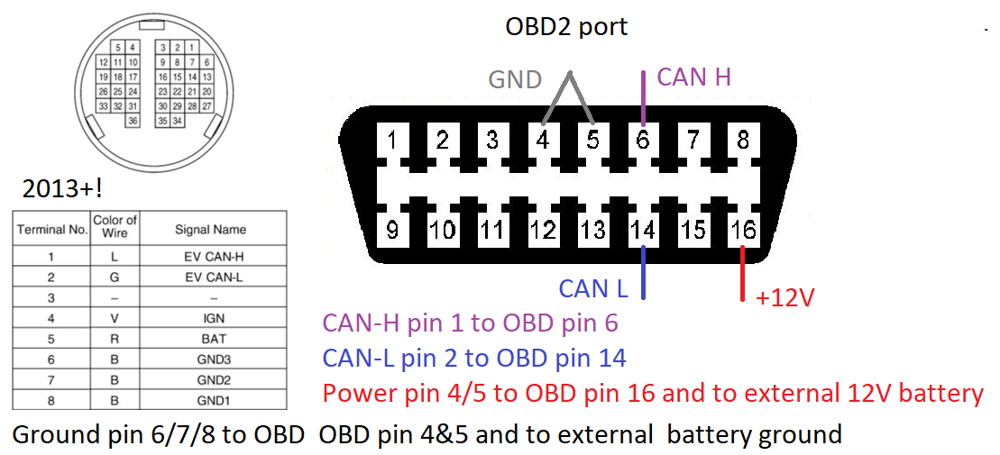

These pictures show it for AZE0/ZE1. For the ZE0 2011-2012, it's similar; you just need to use the other Yazaki connector, with different pin locations (see above for pinout).

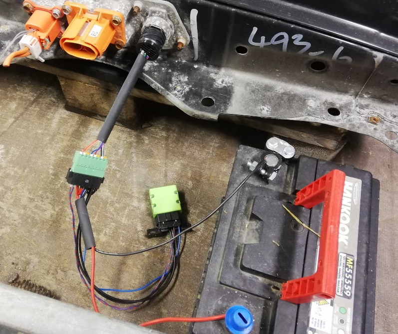

⚠️ To ensure you don't deal with an insulation-faulted pack ([see video](https://www.youtube.com/watch?v=Ug9YdxXqkJ4)), measure DC voltage between each contact of the service disconnect switch and the case (do this with the pack completely powered off and disconnected from anything). You should see the DC voltage slowly decrease to 0 (wait until it is close to 0 on both). If you see a constant voltage standing still between the battery casing and any of the contacts, that pack likely has an insulation fault and may be dangerous to use!

