## Types of compatible Fronius inverters

The code works with the following Fronius inverters:

* Fronius Primo Gen24 Plus (all sizes) ✅
* Fronius Symo Gen24 Plus (all sizes) ✅
* Fronius Symo Gen24 Plus SC 12.0 ✅
* Fronius Symo Hybrid 3.0/4.0/5.0-3-S ✅ (ℹ️ Legacy, no longer available)
* Fronius Verto Plus (all sizes) ✅

On the date of 23.04.2025 Fronius deployed a firmware update that momentarily broke compatibility with Battery-Emulator. This was fixed and interoperability was restored.

- ROW 1.35.8-1 (Working ✅ ) worked with BE versions **below** 8.11.0
- ROW 1.36.5-1 (Breaks ❌ ) worked with BE versions **above** 8.12.0
- ROW 1.41.11-1 works with the current BE version (as of 2026-08-12).

It is recommended to always use latest software version of both the Fronius inverter and the Battery-Emulator.

!!! important "Advice"
    Always read manufacturer's release notes before upgrading the firmware. You can save yourself from a serious amount of trouble by not upgrading to a version which may state that radically changes compatibility level with the emulated battery. Downgrading Fronius firmware to old versions is not possible.

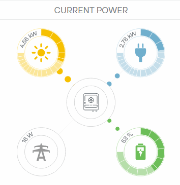

### Hardware limits :zap:

* Fronius GEN24 **Symo 3-5kW** inverters are capped to max **12.5A** on the battery port.
* Fronius GEN24 **Symo 6-12kW** inverters are capped to max **22A** on the battery port (also the SC model).
* All Fronius GEN24 **Primo** inverters are capped to max **22A** on the battery port.
* All Fronius **Verto** inverters are capped to max **50A** on the battery port.

This means that if you have a high voltage battery (450V), you will see much higher charge/discharge power (22A x 450V = 10kW), compared to a low voltage battery (22A x 250V = 5,5kW)

Keep this amperage limit in mind when choosing a battery for the Fronius!

!!! note "Software limits :floppy_disk:"
    There is a non-Plus variant of Gen24 available, for this you have to purchase a battery license before you can add a battery to the configuration. In **System > Information > License** you should see something like below. Contact your installer incase "Battery Operation" feature is missing!

    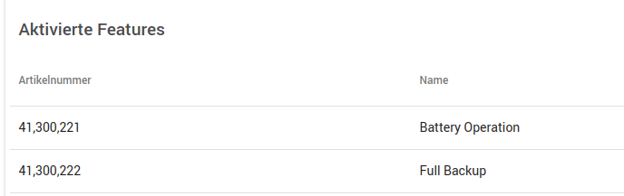

    This can also be seen from the label on the inverter, incase "Plus" is missing:

    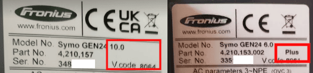

## Setting up the Fronius inverter with Battery Emulator

You will need a **technician** login to the inverter to make changes to the setup. Contact your solar installer in case you don't have the technician login!

!!! note "NOTE"
    You will also need a Fronius Smartmeter so that the system can measure consumption and generation. 

Setup for battery operation is done via the inverter's web UI in **Device Configuration > Components > Add Component > Battery**. Select the battery type matching the [Storage protocol version you chose](#which-protocol-to-use): **BYD HVS/HVM** for *Version 1*, or **BYD HVS+/HVM+/HVB, UL Battery** for *Version 2*:

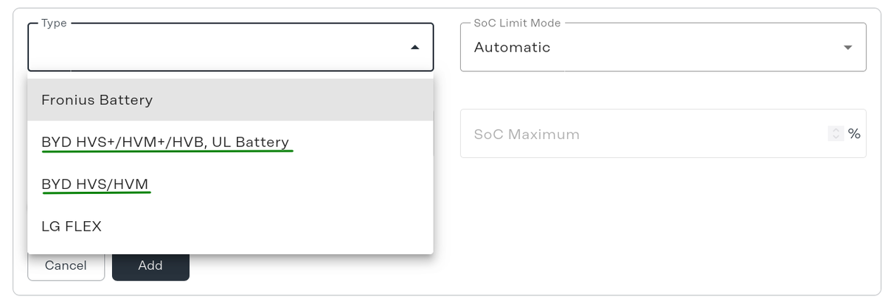

After adding the battery, connect the Modbus/RS485 terminals of the Battery-Emulator hardware to the inverter ([Waveshare ESP32‐S3‐RS485‐CAN](../hardware/waveshare_esp32_s3_rs485_can.md) and LEAF battery example):

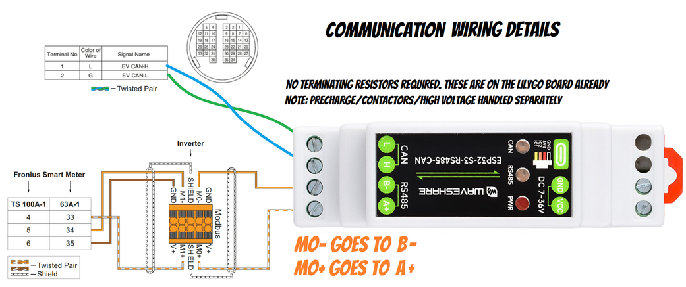

When the low voltage communication is handled, also connect the high voltage side (Nissan LEAF battery example):

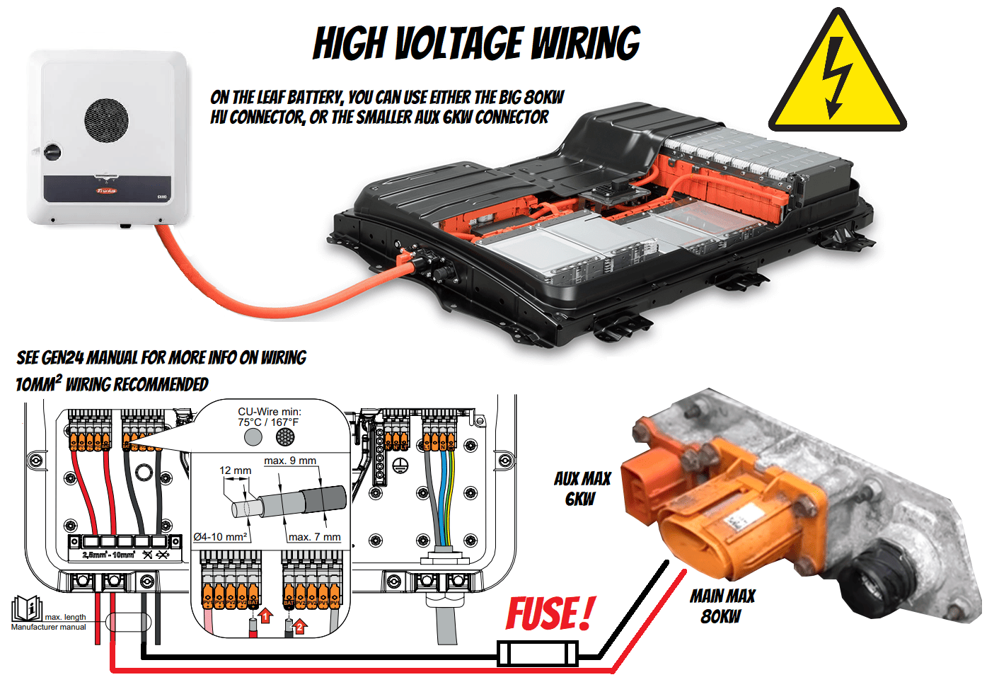

!!! warning "WARNING"
    New hardware requirement for Fronius :warning: Battery voltage is reported towards Fronius inverters only after contactors are engaged. **This means that old legacy installs using manual A/B/C switches for turning on battery contactors will no longer function with Fronius inverters.** Only automatically controlled  contactors via GPIO or CAN will work. This is a new stricter safety requirement to get the Fronius inverter to startup faster and with less errors. 

### Choosing a Storage protocol version {#which-protocol-to-use}

Battery Emulator talks to a Fronius inverter with Fronius' storage protocol, which comes in two versions. Both use the same Modbus RS485 wiring. In Battery Emulator, select **Fronius Generic Storage** under **Inverter protocol** and the version under **Storage protocol**. 

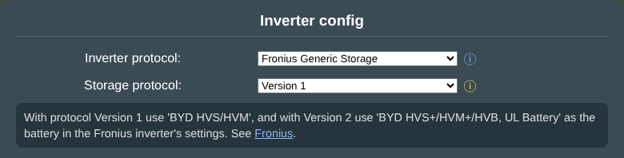

In the inverter, select the battery type that matches the version. The main page then shows the protocol as *Fronius Generic Storage v1* or *Fronius Generic Storage v2*.

| Storage protocol in Battery Emulator | Battery type to select in the Fronius inverter |
|---|---|
| [Version 1](#version-1) | **BYD HVS/HVM** |
| [Version 2](#version-2) | **BYD HVS+/HVM+/HVB, UL Battery** |

**Version 1** makes the battery look like a BYD Battery-Box Premium HVS/HVM. It is the established way of connecting Battery Emulator to a Fronius inverter. Earlier releases offered it as the inverter protocol *BYD HVS/HVM over Modbus*: after updating, such a setup shows up as Fronius Generic Storage with Version 1, and nothing needs changing.

**Version 2** uses the newer version of the same Fronius protocol. The battery appears under its own name, the inverter decides when the contactors close and open, and Battery Emulator's faults show up in the inverter's event log.

#### Comparison

| | Version 1 | Version 2 |
|---|---|---|
| **Battery type in the inverter** | BYD HVS/HVM | BYD HVS+/HVM+/HVB, UL Battery |
| **How the battery identifies itself** | BYD Battery-Box Premium HV, with the same serial number on every Battery Emulator | Manufacturer "Battery Emulator", the battery type selected in Battery Emulator as model (for example "Nissan LEAF battery"), the Battery Emulator version as firmware, and a serial number made from the board's MAC address |
| **Lowest SOC the inverter discharges to** | 5%, fixed by the inverter | 1%, set by Battery Emulator |
| **Contactors** | Closed by Battery Emulator shortly after it starts, then kept closed | Closed and opened as the inverter asks, see [Contactors follow the inverter](#contactors-follow-the-inverter) |
| **Battery size** | Capacity reported to the inverter capped at about 58 kWh, power limits at 30 kW | No caps (not yet tested above 58 kWh) |
| **Battery Emulator faults** | The inverter only sees that the battery is in fault | Each fault becomes an entry in the inverter's event log, see [Faults in the inverter's event log](#faults-in-the-inverter-event-log) |
| **Insulation test** | The battery is never included | Optional, see [Settings for Version 2](#settings-for-fronius-generic-storage) |
| **Status** | Established | New, tested so far on a Symo GEN24 6.0 with firmware 1.42.9-1 |

#### Which one to choose

- Choose **Version 2** if you want to use the battery down to 1% instead of 5%, have a battery bigger than 58 kWh or 30 kW, want Battery Emulator's faults in the inverter's event log, show the real battery type in SolarWeb, or want the contactors to open while the inverter doesn't need the battery (if no backup power is configured in the inverter).
- Choose **Version 1** if you prefer the classic setup faking a *BYD Battery-Box Premium HV*, or if your inverter firmware doesn't offer **BYD HVS+/HVM+/HVB, UL Battery** in its list of batteries.

!!! warning "WARNING"
    Version selected in Battery Emulator **must match** the corresponding battery type in the inverter. Otherwise the inverter may read erroneous data from the battery, as described further down below in the Troubleshooting section.

#### Changing protocol in the inverter {#version-change-inverter}

If you want to switch between the protocols, you need to remove and re-add the battery in the inverter. In the inverter's web UI in **Device Configuration > Components** click on the **trashcan icon** in the battery row to delete it, and press **Save** in the popup that appears:

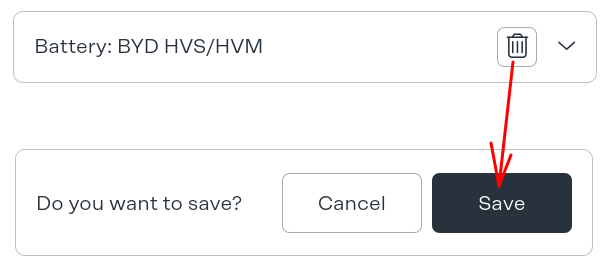

After saving, the page will offer again the possibility to **Add Component > Battery**, where you can select the battery type matching the protocol you'd like to change to.

!!! note "Note"
    The inverter may pop up a warning *A bat­tery has been de­tec­ted, but is not con­figured.* during these steps, which is normal.

!!! info "Service Message 995"
    If your inverter is registered in Fronius's [Solar.web](https://www.solarweb.com) service, 36 hours (by default) after you change the battery type in the inverter you'll get a Service Message `995 (Error)` with the description `Communication failure of the Battery (Battery Blackout Detection Function)`. This just means that the cloud system doesn't get reports anymore about the old battery you removed from the config. It's safe to ignore this message. Note that if you experiment by exchanging protocol versions (and the corresponding battery types) more often, you'll get the message after each time you do the change. You can change the timeout (hours) or even disable the message by logging into Solar.web, going to *Settings* → *Service Messages* → *EDIT* and change the value for *No connection to battery since [h]*.

### Version 1 {#version-1}

In Battery Emulator, select **Fronius Generic Storage** under **Inverter protocol**, **Version 1** under **Storage protocol**, and **Modbus** as the **Inverter interface**. In the inverter, the battery type is **BYD HVS/HVM**.

The battery identifies itself as a *BYD Battery-Box Premium HV*. Battery Emulator closes the contactors on its own shortly after it starts, and keeps them closed; the inverter has no say in it. The inverter doesn't discharge the battery below 5% SOC, a limit it fixes for this battery type.

### Version 2 {#version-2}

In Battery Emulator, select **Fronius Generic Storage** under **Inverter protocol**, **Version 2** under **Storage protocol**, and **Modbus** as the **Inverter interface**. In the inverter, the battery type is **BYD HVS+/HVM+/HVB, UL Battery**.

The battery identifies itself to the inverter with manufacturer "Battery Emulator", the battery type selected in Battery Emulator as model (for example "Nissan LEAF battery"), the Battery Emulator version as firmware, and a serial number made from the board's MAC address. Capacity and power limits are sent without the caps of Version 1, and the inverter can use the battery down to 1% SOC.

#### Contactors follow the inverter {#contactors-follow-the-inverter}

With this protocol the inverter tells the battery which operating mode it wants, and Battery Emulator closes and opens the contactors to match:

| The inverter asks for | Contactors | Battery Emulator reports |
|---|---|---|
| **Inactive** | Closed, through the usual precharge if they were open | Standby while they close, then Inactive |
| **Active** | Closed, left as they are | Active |
| **Standby** | Opened, once the inverter has seen Standby | Standby straight away |

Inactive means the battery is connected but no current flows, the same as Battery Emulator's **Pause**.

The inverter puts the battery into Standby when it has reached its minimum SOC and there is no PV. It only does this if **no backup power is configured in the inverter**: with backup power it keeps the battery Active at all times, ready for a grid outage, so the contactors stay closed just as with Version 1.

Before opening the contactors, Battery Emulator first reports Standby, then waits until:

- the inverter has read the new state, since opening sooner makes it report *DC connection between inverter and battery interrupted*,
- at least 3 seconds have passed,
- and the current has dropped below 2 A, or 10 seconds have passed.

If the inverter doesn't read the state at all, the contactors open after a minute.

After Battery Emulator starts, the contactors close only once the inverter asks for the battery. Until then the main page shows **Inverter allows contactor closing: ✗**.

!!! note "New"
    Version 2 is new. So far it has been tested on a Symo GEN24 6.0 with firmware 1.42.9-1. If you try it on another model or firmware, please report back how it works.

#### Faults in the inverter's event log {#faults-in-the-inverter-event-log}

Battery Emulator reports its faults (events at error level) to the inverter, which lists them in its event log with the texts it has for BYD batteries:

| Battery Emulator event | Shown in the inverter as |
|---|---|
| CAN_BATTERY_MISSING | The battery control unit (BCU) cannot communicate with all the battery modules |
| CELL_CRITICAL_UNDER_VOLTAGE | Cell Under Voltage 3 |
| CELL_CRITICAL_OVER_VOLTAGE | Cell Over Voltage 3 |
| BATTERY_OVERHEAT | Charge Over Temperature 3 |
| THERMAL_RUNAWAY | Cell Failure |
| INTERNAL_OPEN_FAULT | Battery Break |
| HVIL_FAILURE | Hardware fault at the battery control unit (BCU) |
| AUTOMATIC_PRECHARGE_FAILURE | Pre-charge Fault |

Where an event also exists for a 2nd or 3rd battery, those are reported too, except a missing 2nd or 3rd battery, which is only a warning. Events at warning or info level, such as BATTERY_ISOLATION or CELL_DEVIATION_HIGH, are not reported.

Each fault is reported once, dated by [Battery Emulator's clock](#battery-emulators-clock), which follows the inverter's. After a power cycle that clock waits for the inverter's next time, which can take up to an hour. Faults that occur before then are held, and show up in the inverter's event log as soon as the time arrives, dated when they occurred. Battery Emulator holds the last 10 faults this way.

## Settings {#other-settings}

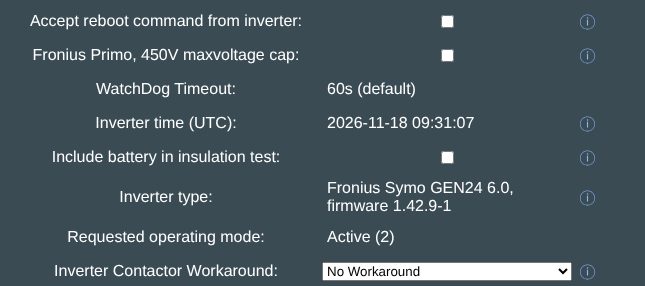

**Accept reboot command from inverter**, as the name says, when a non-zero `RebootCommand` is written by the inverter to Modbus register `407` (`507` with Version 2) will trigger the reboot of the emulator, pausing charge/discharge and opening the contactors first. Disabled by default, will raise an event. If you get this event, it's recommended to reboot Battery Emulator as soon as possible.

**Fronius Primo, 450V maxvoltage cap**: see [Invalid battery size detected](#invalid-battery-size-detected).

**WatchDog Timeout** is set by the inverter when it powers up, and is 60s by default. This is the time interval the inverter and Battery Emulator check each other for correct operation. It's persistently saved to flash. It's displayed purely for informational reasons, just like **Inverter time (UTC)**, which is communicated by the inverter once per hour (shows "not yet received" after boot, until the first packets arrive). Battery Emulator sets its own clock from it, see [Battery Emulator's clock](#battery-emulators-clock).

!!! note "NOTE"
    If you intend to use the [Periodic Reset](../setup/hardware/periodic_bms_reset.md) option with your battery, make sure to enable the "Defer reset if SOC less than 15%" option to avoid charging from grid if you reached the reserved level, and if Battery Emulator would want to do that at night.

Besides the these, Version 2 adds:{#settings-for-fronius-generic-storage}

**Include battery in insulation test**: when enabled, the inverter includes the battery's DC path in its insulation measurement, by closing its contactors. This only matters actually when **no backup power is configured in the inverter**: with backup power it keeps the battery Active at all times, ready for a grid outage, and since the contactors stay closed continuously, the insulation test will include the batteries anyway. The inverter reads this setting only when it sets up the battery, so restart the inverter after changing it, or remove and re-add the battery. OFF by default.

**Inverter Contactor Workaround**: with **No Workaround** (the default) the contactors follow the inverter as described above. **Keep contactors always closed** keeps them closed regardless, and **Lock contactors closed after first close request** keeps them closed from the first time the inverter asks for the battery. The state reported to the inverter follows its requests either way.

**Inverter type** shows the name and firmware version the inverter has sent, for example *Fronius Symo GEN24 6.0, firmware 1.42.9-1*. The inverter only sends them while it has not detected the battery yet. They are purely informational, so Battery Emulator does not save them, and a reboot clears them. **Requested operating mode** shows the last mode the inverter asked for. Both read "not yet received" until the inverter has sent them.

## Following it in the log {#fronius-generic-storage-log}

In the [log](../setup/software/webserver_guide.md#log), all lines of this protocol start with `Fronius: `, for example:

```text
Fronius: Inverter identifies as "Fronius Symo GEN24 6.0", firmware 1.42.9-1
Fronius: Inverter requests operating mode 1 (Inactive)
Fronius: Reporting state 1 (Inactive) to the inverter
Fronius: Inverter requests operating mode 2 (Active)
Fronius: Reporting state 3 (Active) to the inverter
Fronius: Inverter requests operating mode 0 (Standby)
Fronius: Reporting state 0 (Standby) to the inverter
Fronius: Inverter has seen STANDBY, contactors may open (4012 ms)
```

## Battery Emulator's clock {#battery-emulators-clock}

Battery Emulator has no network time, so with either version it sets its clock from the time the inverter sends once an hour. Once set, the time (UTC) is shown at the bottom of the main page's [status card](../setup/software/webserver_guide.md#system-status), and Version 2 dates the [faults it reports](#faults-in-the-inverter-event-log) by it.

The clock keeps running through a restart of Battery Emulator, such as **Reboot Emulator**, a crash or the inverter's reboot command, if the inverter sent its time in the 2 hours before. It may then be slightly off until the inverter's next time corrects it. After a power cycle the clock is not set, and the main page shows no time until the inverter sends it, which can take up to an hour.

## Notes on Scaled SOC + Fronius min/max SOC

In the Fronius settings it is possible to configure "SoC Minimum" and "SoC Maximum" values. If you are using the [Rescale SOC](../setup/software/webserver_guide.md#rescale-soc) functionality in the Battery-Emulator, you will be applying double-rescaling of the usable capacity. It is recommended to always leave in Fronius the "SoC Maximum" to 100%, and adjust the "SOC max percentage" setting in Battery Emulator instead, to be able to take advantage of the "Charge power tapering based on SOC" which avoids power oscillations.

Avoid double-rescaling:

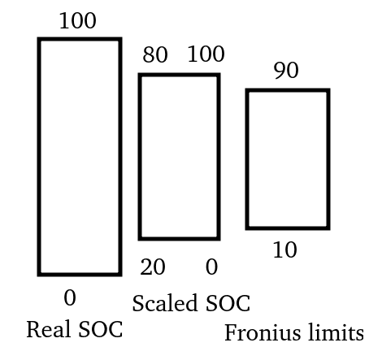

!!! important "IMPORTANT"
    Fronius's **BYD HVS/HVM** implementation (Version 1) limits SOC minimum to 5% to avoid battery undercharge when sitting idle empty. It does a trickle charge/discharge cycle during an *Energy saving mode* procedure. Thus, if you enable **Rescale SOC** in Battery Emulator, keep in mind of this requirement at the low end.

    With **Version 2** the minimum is 1% instead, set by Battery Emulator.

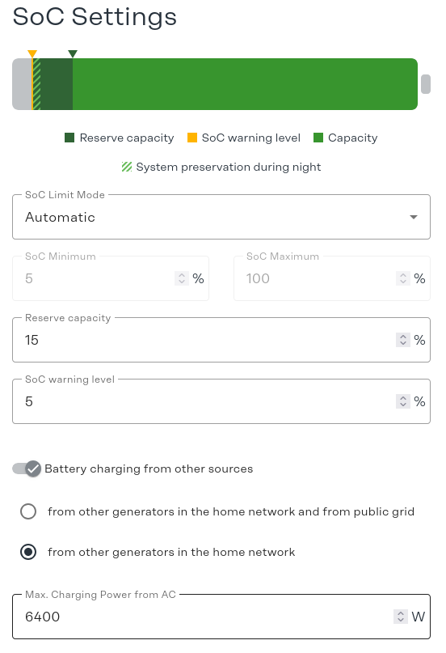

Optional setting: If you have multiple AC coupled inverters in your network, and they all reside behind the SmartMeter, you can enable **Battery charging from other sources** and select **from other generators in the home network**.

## Starting and stopping the system

When turning the system on, follow this startup procedure. Work quick, to avoid the inverter getting stuck in battery not detected mode, but pay attention to each step.

### Startup

1. Power on the Battery-Emulator hardware and the EV battery respectively
2. Turn on the Solar DC switch and the Battery DC switch if there is any
3. Set the DC disconnector to the "On" switch position on the Fronius inverter
4. Start the Fronius inverter via AC breaker
5. Wait until contactors close at the EV battery (CAN controlled / GPIO control), and Fronius will start to use it. With Version 2 they close when the inverter asks for the battery

### Shutdown

Important to note when shutting down is to not open any DC breakers/isolators under load! Doing so can cause DC arcs and prematurely wear them out, and in worst case start a fire.

1. Signal to the inverter that battery is not available, with any of the following options:
   
       - Press PAUSE in the Webserver (best option)
   
       - Press optional Equipment stop if installed
   
       - Press Open contactors in the Webserver
       
3. Once Fronius stops using battery after a few seconds (verify in app to make sure) it can be powered down
4. Turn off the Fronius inverter via AC breaker
5. Turn off the Fronius inverter via the DC switch on the Fronius itself
6. Turn off the Battery DC isolator switch
7. Turn off the Solar DC isolator switch

## Troubleshooting

### Day to day monitoring

The performance of the system can be tracked with the app "Solar.web". This app gives direct info on current output/input, SOC% level of battery, graphs, and more. No settings can be changed via this app, but it is a great tool for visualizations and quick status checks. You can also see at a glance if an inverter firmware update becomes available for you.

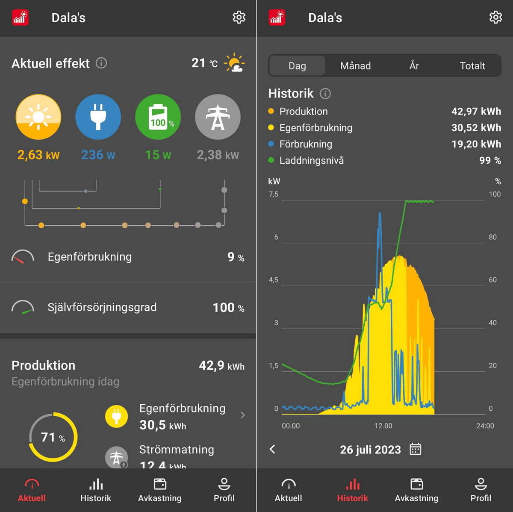

### Battery not detected

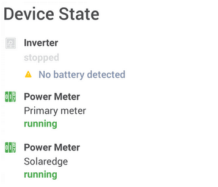

If you see `No bat­tery de­tec­ted` or `No bat­tery voltage meas­ured but bat­tery is act­ive` in the **Service Messages**:

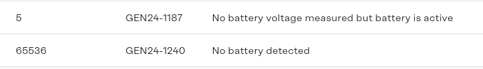

Then verify the following:

- Make sure High Voltage is present on inverter battery input. Also make sure the DC isolator switch on the front of the Fronius is turned ON

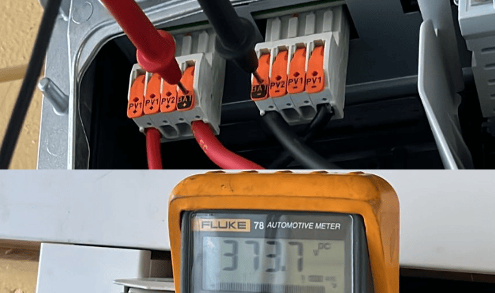

- Make sure the Precharge/Positive has not been accidentally swapped (Easy mistake on GPIO controlled packs). This will show up as voltage still on inverter pins, but as soon as any load is put on the system the voltage will sag heavily and inverter will report **Battery not detected**.
- If using PWM contactors, make sure they are not dropping voltage momentarily. Try disabling PWM.
- Next step is checking that Modbus connection is active. Check the Events page, if you see this MODBUS_INVERTER_MISSING event;

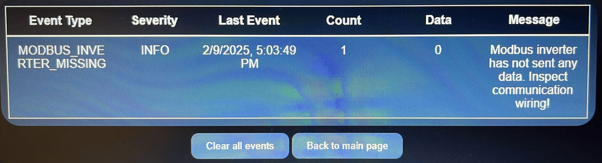

It means that the Modbus connection is down. Verify that:

- Polarity of M0+ and M0- is correct
- Protective earth is attached in both Inverter and Battery side
- Modbus cable shielding drain wire is attached only at one end
- Wires are seated correctly in the Fronius connector. It is very easy to miss that the wires are not pushed in all the way.
- Try a different power supply for the Battery Emulator board. Powering it via USB from a computer can cause noise on the signal output. Powerbank or phone charger might have cleaner voltage output. If you see strange modbus errors, your power supply might be noisy.

Make sure the Battery-Emulator has a good modbus connection to the Inverter.

 - Use shielded twisted pair cable for a stable connection
 - If you see `ModbusServerRTU.cpp [252] serve: RTU received: E5 - packet length error` in the [logs](../setup/software/webserver_guide.md#log) of the board, it is an indication that wiring is not perfect and occasionally get corrupted

### Invalid battery size detected

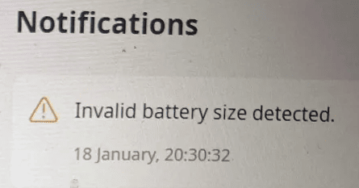

If you see this error, it might be because the battery you are using is having higher allowed maxvoltage than the Fronius inverter accepts. A good example is using BYD Atto3 battery (Max 460V), with a Fronius Primo single phase inverter, that only can take 450.

A quick solution is to enable the "450V maxvoltage cap" setting. This fakes it so that all batteries appear as 450V max. 

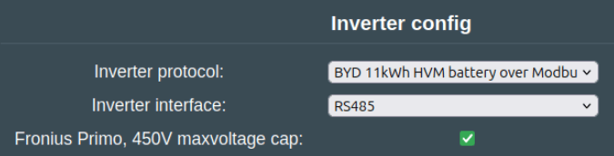{ width="675" height="172" }

!!! danger "Note"
    This setting should not be used with Fronius Symo 3-phase inverters. These inverters are designed to work with battery voltages up to 700VDC.

!!! note "Notes on reported capacity"
    With **Version 1**: Fronius inverters are designed to work with maximum 3x22kWh BYD batteries, and the protocol has a max value of 65535 Wh (unsigned 16bit value) for reporting Wh towards inverter. That means we have to restrict reported Wh number towards the inverter, for example when using a 75kWh Tesla battery, it will show up as max 58kWh in Fronius portal. This is just a REPORTED value, you can still use the full capacity of the battery. For instance, a 400kWh battery will be displayed as 58kWh, but the inverter will still be able to use the full 400kWh.

    With **Version 2** the capacity is sent as a 32-bit value and reported in full.

### DC connection between inverter and battery interrupted

The inverter reports *DC connection between inverter and battery interrupted (! battery cannot be charged anymore !)* (GEN24-1250) when the battery's DC connection drops while the inverter is counting on it. That can happen when the contactors open on a fault, from the **Open contactors** button or the equipment stop, or during a periodic BMS reset.

With Version 2, contactors opened on the inverter's request wait until it has seen the battery go to Standby. If the message appears anyway, the [log lines starting with `Fronius: `](#fronius-generic-storage-log) show what the inverter asked for and what Battery Emulator reported before it.

### Battery enable signal is missing or erroneous readings

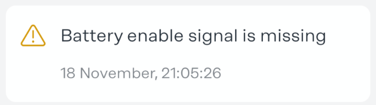

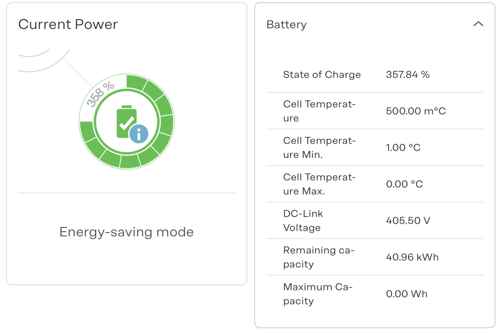

These errors are caused by protocol version mismatch between the inverter and Battery Emulator. Choose the correct battery type for the protocol version selected in Battery Emulator.

## Off-Grid/Backup Configuration

Symo/Primo Gen24 inverters that are smaller than 6.0kW are **not** compatible with running full backup mode (the Primo 5.0 is). On these smaller inverters, your best bet is to utilize the PVpoint outlet to get power out of the battery.

A Smart-Meter is mandatory for battery use when connected to a grid (or generator). However, the Gen24 can run 'Off-Grid' if configured specifically for this scenario and limitations. 

To run the Gen24 as off-grid but have the facility to connect to a grid (or generator) at some point, then you must follow the Full-Backup configuration design as documented by Fronius. 

If you intend to never connect the inverter to a grid source (or generator), then you can hard wire the Gen24 in Full-Backup mode. In both cases, the smart-meter **MUST NOT** be detected when running in Full-Backup mode. 

If needed for a future grid or generator power source, the smart-meter can be wired in as per normal ready for a grid or generator input, but the modbus comms (D+) must be disconnected to ensure it does not send data to the Gen24. If the gen24 detects a smart-meter when running in full-backup, then it assumes the grid is connected and will shutdown the inverter and not work reliably.  

To hard wire the Gen24 as off-grid and 'cold-start' using the EV battery pack or PV, I/O pins 6 and 7 need to be jumpered to the V+ on the I/O connector as shown below. 

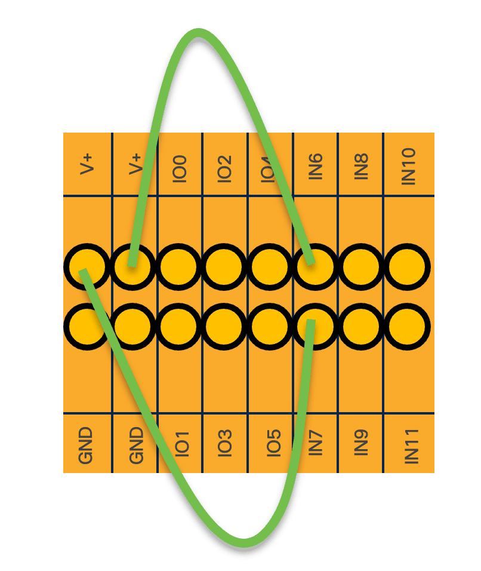

Additionally, Full-Backup mode needs to be configured on the Gen24 as follows:

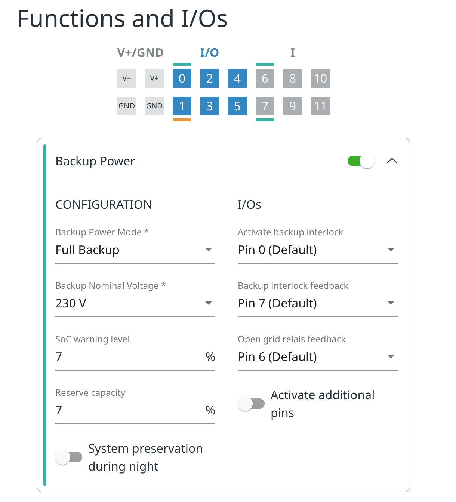

Pin0 is not used when hard wiring for full backup. Pin0 is used for automatic switchover to full-backup int the event of a grid failure. Follow the Fronius documentation for this type of configuration. 

The Fronius Gen24 configuration documents describe both automatic and manual switch-over to backup mode using combination of switches and/or relays. Both options can be commercially sourced if you need a non hard-wired off-grid only solution. 

!!! note "NOTE"
    When running as Full-Backup, the inverter will run by default at 53Hz. As such, no other inverter can be active on the AC circuit. Only the Gen24 can be providing power! If you need additional power, then a true Micro-Grid should be used (AC coupling with Victron etc).

!!! warning "IMPORTANT"
    Fronius officially supports a maximum of 2000h off-grid (full-backup) per year on the Gen24. Exceeding this hour count voids the warranty. There are no reports of any inverters shutting down after 2000hours. 

    To get around this off-grid limitation, you can create a microgrid using a 48V battery that powers a small inverter, and then connect the Gen24 to this microgrid. Then it will be essentially offgrid, without incrementing the 2000h max counter. Example of this running successfully has been done with a Victron a 7.2kwh(LV) , and FroniusGen24 with a 75Kwh battery(HV). A smart meter is required if running as a true micro-grid.

All normal earthing requirements when running in 'off-grid' must still be followed. Consult a qualified electrician for advice. 

## Advanced control of energy (Spot price, scheduled charge/discharge etc.)

Once you have your battery connected to the Fronius, it is possible to add additional hardware into the mix for advanced control of how energy should flow in the system. This is useful for those with spot-price electricity, or a nightly tariff. Below are some examples you can utilize to control the Fronius Gen24 directly via Modbus TCP.

- You can setup forced nightly charging via the webinterface of the Gen24 (Requires connecting to the inverter directly, not available via SolarWeb). This is very useful if you have a cheap night tariff, and want to charge the battery during the night and use the energy during the day
- [Arska-node](https://github.com/Netgalleria/arska-node/) reads Nordpool electricity prices (from EntsoE/Elering) and renewal energy forecast (solar from Open Meteo, solar/wind from Finnish FMI) as well as local real-time net power consumption/sales (smart meter HAN P1-port -tested in FI, Shelly 3EM). Based on this and time based data (+ optional ds18b20) the system updates variables ([github/Netgalleria](https://github.com/Netgalleria/arska-node/wiki/Channels#variables)) which are used in channel rules deciding whether the channel should be up/down/charging/discharging. Arska has also basic load management functionality (limits loads if consumption exceeds given limits). So far users have used the system mainly to optimise self-consumption of PV production and for scheduling flexible consumption at the cheapest time and selling any surplus when the price is high. Arska has controlled (through GPIO, Shelly and Tasmota relays) water boilers and (underfloor) heating. According to the developer, version 1.3 controls the Fronius GEN24 charging/discharging parameters (nWRte, OutWRte, StorCtl_Mod) based on given channel rules.
- Info on how to [control Fronius Modbus via Homeassistant (German)](https://www.libe.net/byd-modbus)
- [SBAM: Charge Fronius battery using SolCast weather forecast](https://github.com/atbore-phx/sbam/tree/main)
- [This integration](https://github.com/callifo/fronius_modbus) gives you full control over the charge and discharge of the battery.


