DC wire sizing is a very important part of planning your bat10 mm²build. Most inverters accept 6 mm² or 10 mm² (check your inverter manual for more info), but most EV packs are 50 mm². This creates a small problem: you will need to step down this wire size. When stepping down, it's a good idea to install fuses as close to the battery as possible to protect your wiring. 

## Wires and fuses
### Wire gauge (cross-sectional area)

!!! note "NOTE"
    Since multiple people have assumed that 4-way connecting blocks are 2x2, which can result in a short circuit, please double-check continuity for all components before installing!

* When selecting the hardware (wires, fuses, switches), make sure they are rated for the DC voltages in your system. Hardware designed for solar often works well with EV batteries. Do note that if you are using a 600V battery, you need to buy hardware rated for 1000VDC; 500VDC certification is not sufficient.
* Also keep in mind that longer DC cabling will cause larger voltage drops. Try to keep the DC wiring run as short as possible. 20-30 meters is acceptable, but if you go farther (~80 m?), you will need a much larger-gauge wire to avoid power loss. For instance, 10-25 mm² might be required when going longer. Use a voltage-drop cabling calculator for your country to determine the correct cable size for a given distance. To get a picture of how much loss you can accumulate over various lengths of Cu and Al cabling, check out these calculators. A loss of around 1% can be acceptable. (ymmv, this is purely informational!)
    * [Cable Size Calculator AS/NZS 3008](https://www.jcalc.net/cable-sizing-calculator-as3008)
    * [Spreadsheet for manual calculations](https://docs.google.com/spreadsheets/d/1rSTNwgxBgrDaf8wo9_7r2cqsKLavUIEs/edit?usp=sharing&ouid=100957746627782596285&rtpof=true&sd=true)

* DC cabling should also be installed in a conduit to avoid any external factors damaging the insulation around the wires. The conduit material can either be plastic or aluminum, depending on what's typical in your region.
* 12V control/signal wire has the same limitations; increase cable cross-sectional area to be able to go longer distances. Check out our [tips for low voltage wiring page](wiring_tips_lv.md)
* Avoid installing communication wires next to high-voltage wiring, in order to avoid signal interference. Keep a 300mm separation between AC/DC and CAN/Modbus cabling whenever possible to avoid interference.

!!! warning "CAUTION"
    Verify the polarity of the HV system before wiring it to the inverter. Many EV batteries don't have markings indicating which side is +/-, so doing a test run without the inverter connected is a good idea to ensure polarity. Incorrect polarity will destroy your system.

Example, 50mm² cable stepped down to 10 mm², and at the same time fused off with a 25A solar DC ceramic fuse:

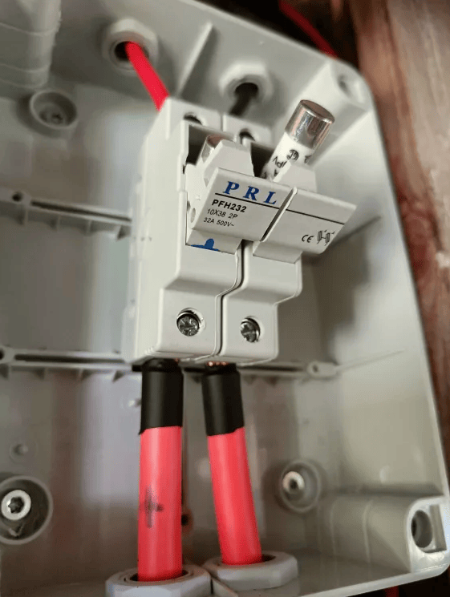

Example: two EV battery inputs stepped down to 10mm² using DC fuses:

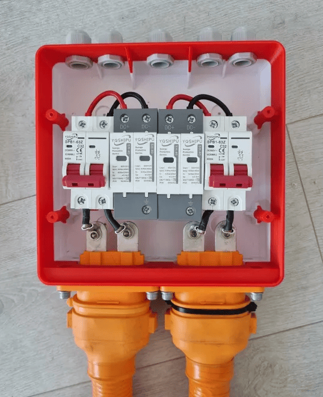

If you just want to step down the wire size (from 50 mm² cable to 10 mm² cable), you can use a terminal block such as [UKK 160](https://s.click.aliexpress.com/e/_c36053wp)

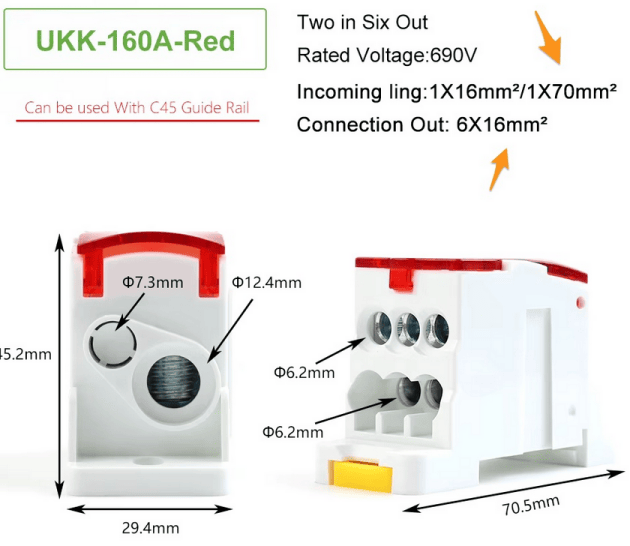

If space is an issue, you can use this: [1 module 150A terminal block](https://s.click.aliexpress.com/e/_c4lHpV37):

    - 1 cable in (35mm²), 1 cable out (35mm²)
    - 1 cable in (35mm²), 2 cables out (10mm²)

 { width="300" }

### DC Fuses

#### How large a fuse do I need?
Sizing your fuse depends on your target power (kW) and your battery's voltage *range* — not its nominal voltage.

Inverters draw constant **power**, so as the battery discharges and its voltage falls, the **current rises** to compensate. The highest current always occurs at the lowest battery voltage. A fuse sized using nominal or full-charge voltage will be undersized and may nuisance-blow during long discharges at low state of charge.

**Always use the lowest voltage your battery will reach** (minimum cell voltage × number of cells in series) for the calculation. 
```
Example voltage range assessment
Zoe ZE40 is "96s" — 96 cells in series. Each lithium cell has a safe working window, typically 3.0V minimum to 4.2V maximum:
Pack minimum: 96 × 3.0V = 288V 
Pack maximum: 96 × 4.2V = 403V
```
Then add ~25% overhead, because a fuse's effective rating drops at high ambient temperature — a 25A fuse in a warm enclosure may not reliably carry 25A and may fatigue if run continuously near its rated current.
```
Example calculation, 5kW inverter with a Nissan LEAF battery (96s, 300–400VDC range rounded)
Current at full charge:  I = P/U = 5000W / 400V = 12.5A
Current at empty:        I = P/U = 5000W / 300V = 16.6A  ← sizing point
Fuse size = 16.6A × 125% ≈ 20A fuse required
```
Note the spread: the same 5kW load draws 33% more current at the bottom of the voltage range than at the top. The wider your battery's voltage range, the bigger this effect. If your fuse blows occasionally during long, high-power discharges, this is the most likely cause — recheck the calculation using your true minimum pack voltage.

The fuse must not be used as your current limiter. Set the inverter or Battery Emulator max discharge current *below* the fuse rating (≤80% is a good rule) so the fuse only acts on genuine faults. Fuses can be either DC ceramic or DC DIN-mounted. Make sure the fuse you are purchasing is certified for DC and within your battery's voltage range. 

!!! warning "CAUTION"
    
**Polarized DC breakers should not be used**. These are intended only for solar DC, with a single direction of current flow. 
    
If these are used on batteries that have bidirectional current flow, they will break. For this reason, classic fuses (fusible links) are recommended!

[DF Electric PMX Fuse Holders](https://www.dfelectric.es/products/pmx-fuse-holders/)

[DF Electric 14x51 2-40A 600V DC fuses](https://www.dfelectric.es/products/cyl-gbat-fuse-links-600v-dc/14x51-cylindrical-gbat-fuse-link-600v-dc/)

[DF Electric 22x58 40-80A 600V DC fuses](https://www.dfelectric.es/products/cyl-gbat-fuse-links-600v-dc/22x58-cylindrical-gbat-fuse-link-600v-dc/)

Don't buy cheap products from doubtful sources unless you intend to burn your house down (images courtesy of WJD on Dala's EV Discord):

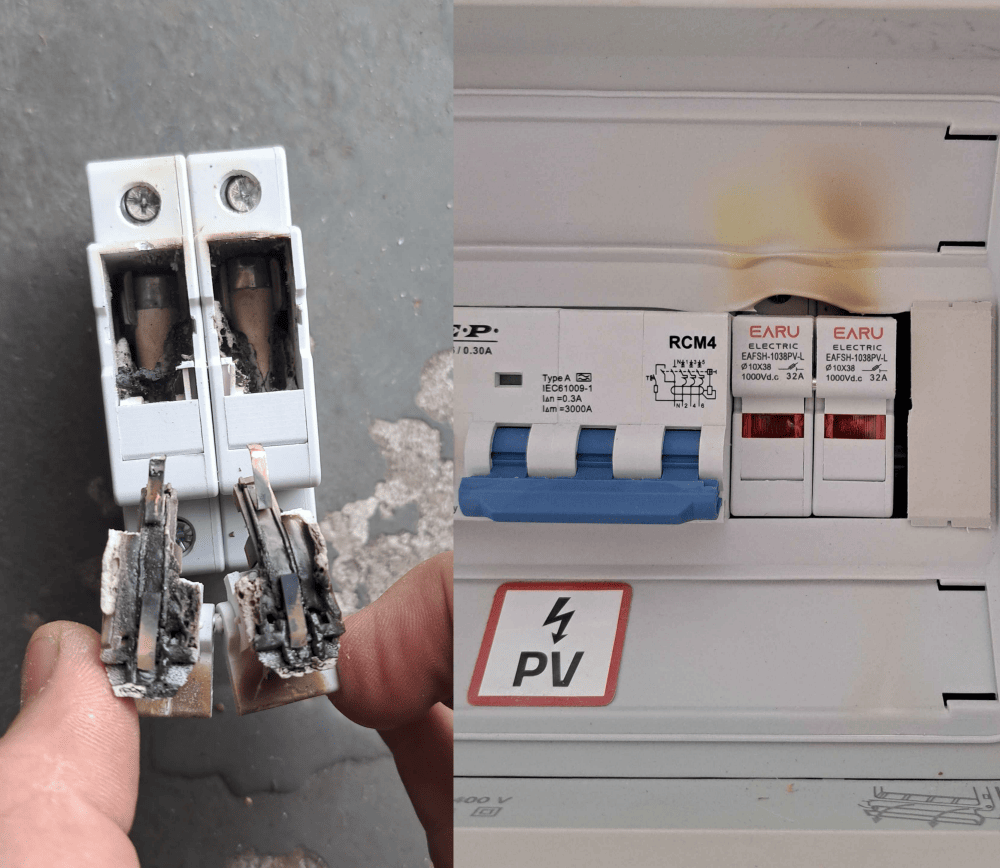

If you want to use DIN DC MCB Fuses, use something like [**Schneider C60PV-DC 800VDC (A9N61660)**](https://www.se.com/be/en/product/download-pdf/A9N61660?filename=Schneider+Electric_Acti9-C60HDC-Acti9-C60PVDC_A9N61660.pdf).

 { width="500" }

#### DC Disconnect switch
Some countries have legislation requiring DC disconnect switches (also known as DC isolation switches). 

The idea is that these switches will be installed in a location where first responders and firefighters can easily turn off your solar/battery system. Check your local legislation to see if this is required in your area.

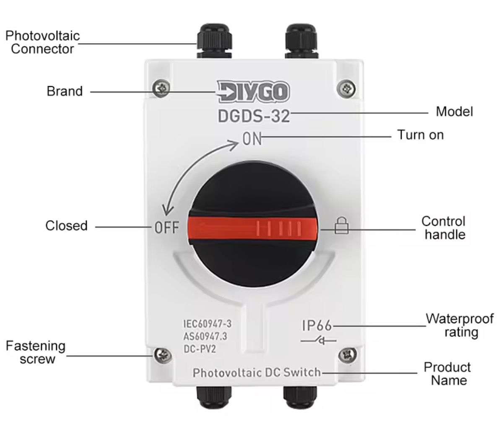 { width="500" }

[IP67 Waterproof 32A 1000V Disconnect Switch](https://imopc.com/imo_uk_gbp_view/enclosed-dc-switch-ip66-6249d58eb8c4a.html)

[TOMZN 4P PV DC 1200V 32A IP66](https://s.click.aliexpress.com/e/_c3oFLKJn)

[DIY GO Disconnect Switch IP66 1200VDC 32A](https://s.click.aliexpress.com/e/_c4SJVDat)

### Protective earth
The battery case **needs** to be connected to protective earth (PE). This is required for a few technical and safety reasons;

- HV Shield. If you are using the OEM HV cables, they contain an outer shield layer. This needs to have same potential as PE, and will automatically become PE once you ground the battery casing.
- Signal integrity. Having the battery case at earth potential avoids ground loops through the communication shield wires.
- CAN transceiver longevity. Failure to attach PE to the battery case can damage CAN bus systems from ground loops through shield wires
- Insulation testing. Your inverter will periodically test the safety of the high-voltage system by measuring the insulation resistance between HV+/- and PE. If the battery case is left free-floating and not connected to PE, any HV leaks might go unnoticed. 
- If you are in a country that requires a residual current device in your electrical panel (GFCI/RCD), these also need to be able to accurately measure any DC leakage to PE and trip

!!! warning "CAUTION"
    **Failure to connect the battery case to protective earth can lead to dangerous situations where high voltage leaks are not detected**

Check out the page with [our tips for proper earthing](lightning_strike.md).
    
Example: Nissan LEAF battery case and all other metallic parts connected to PE:

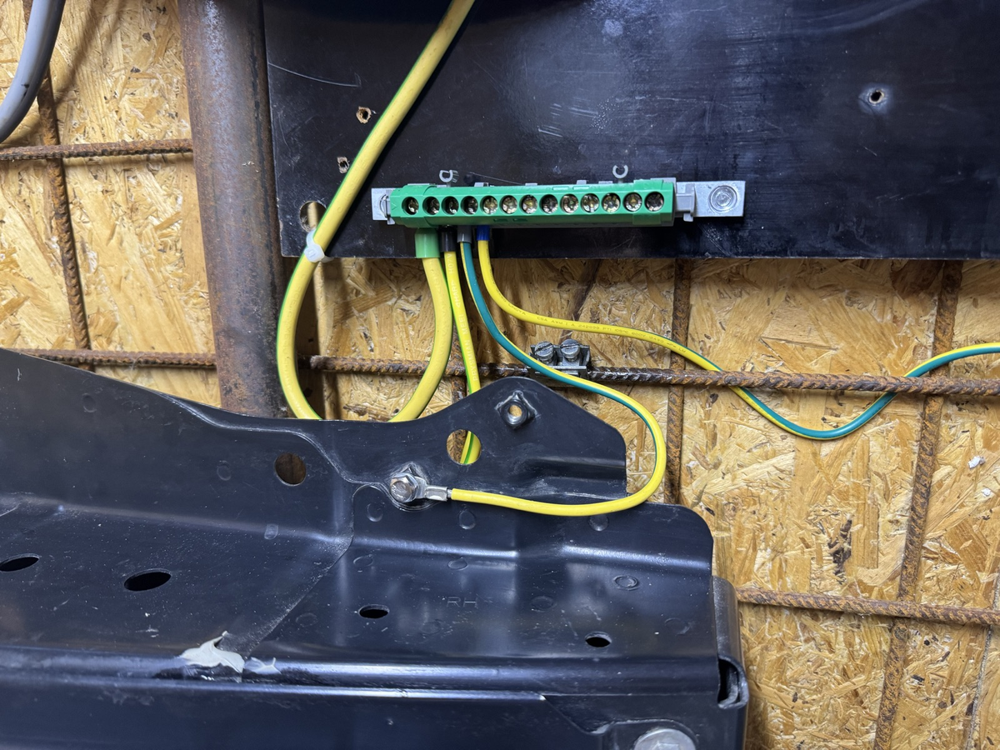

### Loss of isolation :zap: 
If either HV+ or HV- touches protective earth while the system is running, the solar inverter will detect this, display a "loss of isolation / insulation resistance too low" error message, and stop operation. Troubleshooting this can be tricky and requires extreme caution, as high voltage may be present in the protective earth.

Example: wire shielding cut too close to the copper, causing the shield to touch HV. This was causing the inverter to stop operation

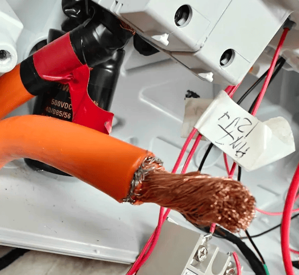{ width="608" height="558" }

Start by checking the easy stuff; measure whether the HV wiring is leaking to PE. If the wiring is OK, the battery itself can also have an internal leak. These are much harder to diagnose compared to external wiring issues. Check out [this video](https://www.youtube.com/watch?v=00eEj_EgMas) for more examples of leakage to ground.

## Terminal tightness :nut_and_bolt: 
Electrical connections can loosen over time due to thermal cycling (expansion and contraction from heating and cooling during charge/discharge cycles). This is especially noticeable on high-power DC systems. A loose connection increases electrical resistance, leading to localized heating, potential fire hazards, and voltage drops that reduce system efficiency.

* **Why it's Important:** Loose terminals are a leading cause of electrical failures. They can cause arcing, melting, and in severe cases, fires.
* Materials Matter:
    * **Copper Lugs/Terminals:** Check torque every 1-2 years.
    * ** Aluminum Lugs/Terminals:** Aluminum is more susceptible to "cold flow" or creep under pressure. Check torque annually.

* Procedure:
    * **Safely de-energize the system** and verify there is no voltage present with a known working multimeter
    * **Use a calibrated torque wrench** and the correct socket.
    * **Consult your manufacturer's manual for the exact torque specification** (e.g., 4-5 Nm or 35-45 in-lbs). On some terminals, the torque value is stamped directly on them. Do not over-tighten, as this can strip threads or damage terminals.
    * Visually inspect terminals for signs of corrosion, melting, or discoloration.

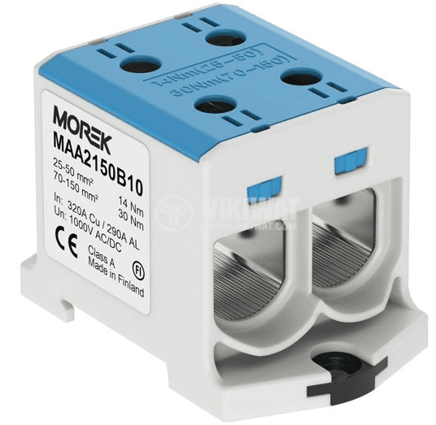{ width="536" height="523" }

Example of a terminal with torque values displayed on the label or case.

## Coolant (for Liquid-Cooled Systems) :sweat_drops:

Liquid cooling is used in some EV batteries to manage battery temperature. Maintaining the coolant is vital for thermal management and preventing corrosion.

- **Why it's Important:** Low coolant levels can lead to poor heat dissipation, causing the battery to overheat and degrade rapidly. Old coolant loses its anti-corrosive properties, leading to leaks and cooling system blockages.
- Coolant Level Check:
    * Frequency: Check every 3-6 months.
    * Procedure: With the system off and cool, inspect the coolant reservoir. The level should be between the "MIN" and "MAX" marks. Top up only with the manufacturer-recommended coolant type. Never mix different coolants.

- Coolant Replacement:
    * Frequency: Typically every 3 to 7 years, but follow the manufacturer's strict interval.
    * Procedure: This is often a very installation-specific task. It involves draining the old coolant, flushing the system, and refilling with new, premixed coolant while ensuring all air is bled from the lines to prevent airlocks.

## See also

- [Lots of useful Safety Earth references](https://www.sciencedirect.com/topics/engineering/safety-earth)

## Examples of wiring installs

Here are some examples of how to wire up the high-voltage output from the battery into a fuse box or DC junction box.

### Nissan LEAF

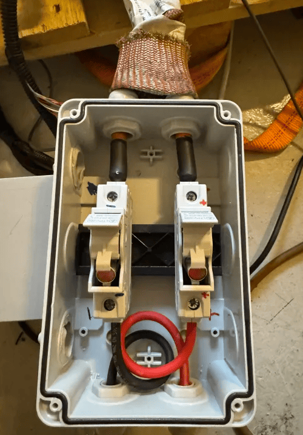
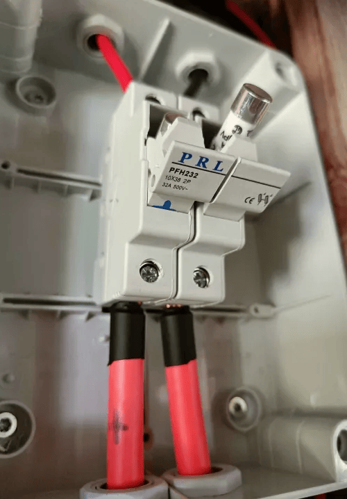operating
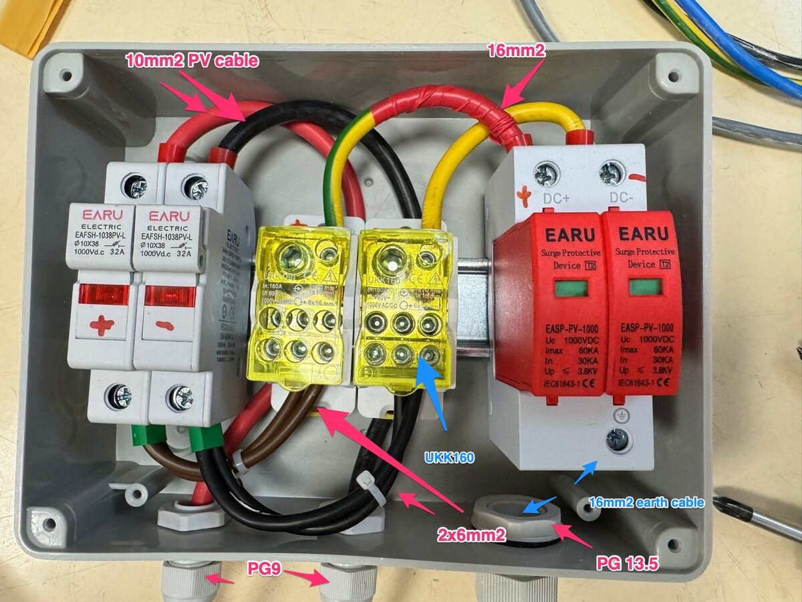


Phoenix 3049408 DIN rail connectors to use with the unmodified cable:

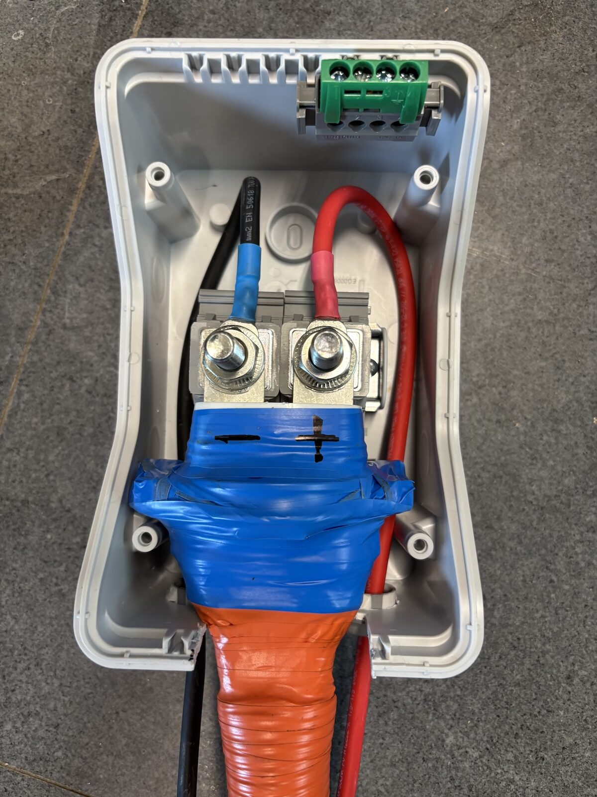

### BMW I3

The BMW i3 uses a 35 mm² high-voltage cable. To connect it to a terminal block and reduce the size to a more manageable 10 mm², you would need ferrules for these stranded wires to prevent damage. This can be done by cutting off the old connector, inserting a ferrule, and crimping it. These tools are not so common for consumers. An alternative is to modify the connector and use the current connector as a ferrule, so you don't have to buy or rent tools to achieve a non-stranded wire for the thermal block with a 35 mm² size. Use at your own risk!

[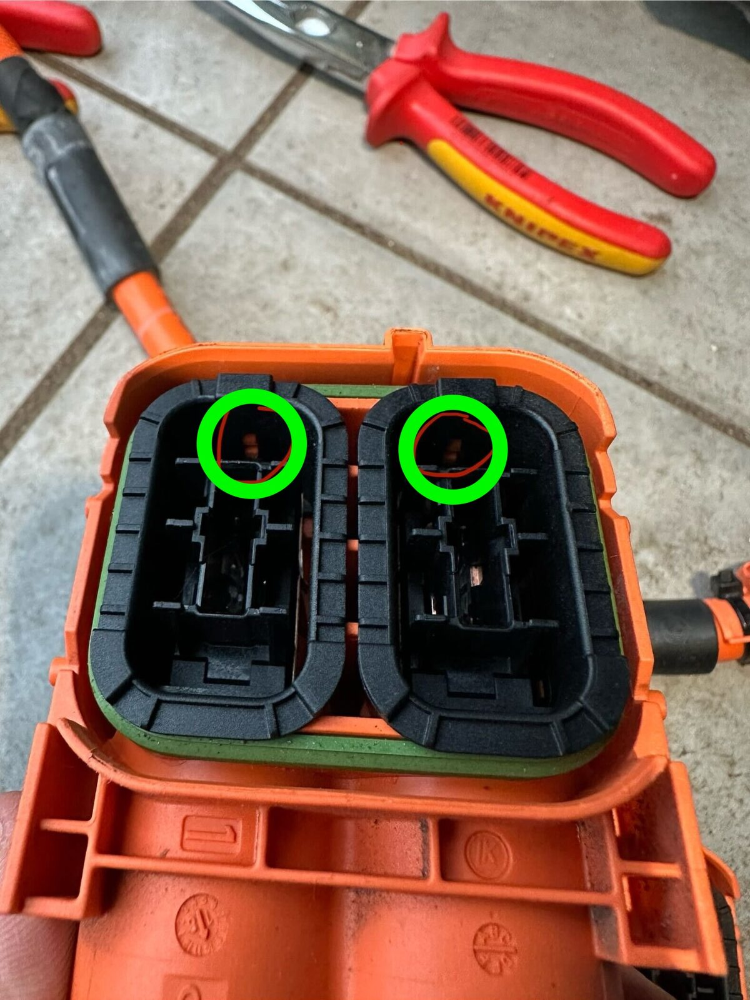{ width="200" }](../../images/bmw-i3-05.jpg)
[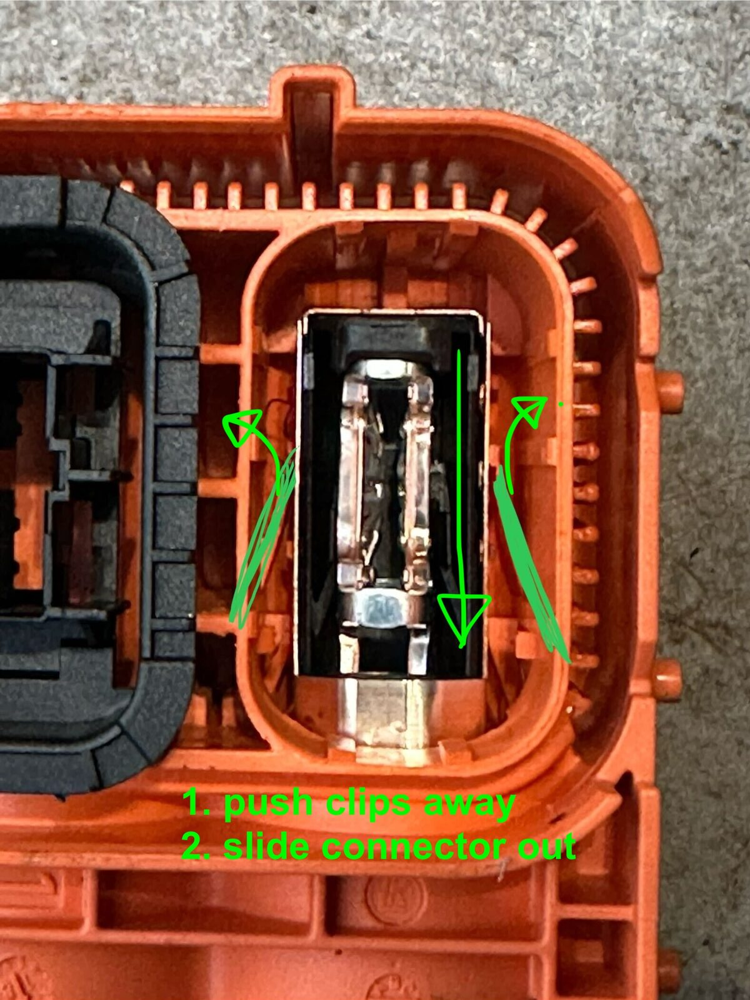{ width="200" }](../../images/bmw-i3-06.jpg)
[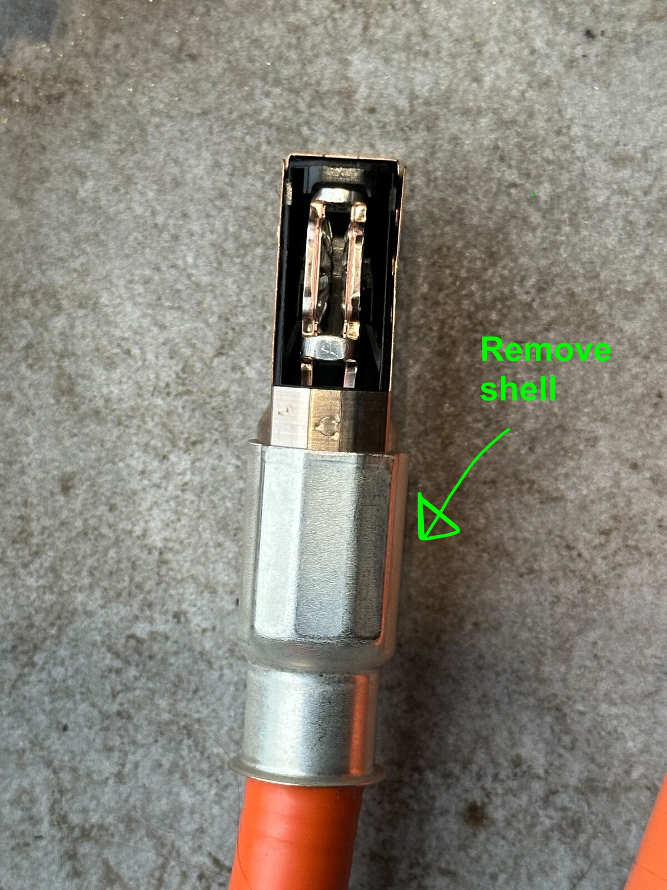{ width="200" }](../../images/bmw-i3-07.jpg)
[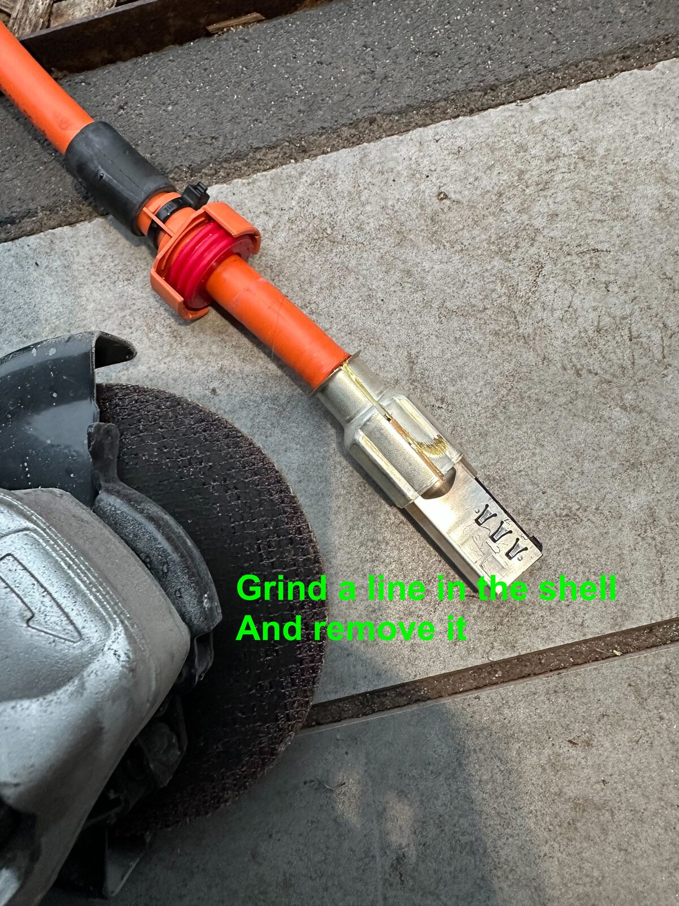{ width="200" }](../../images/bmw-i3-08.jpg)
[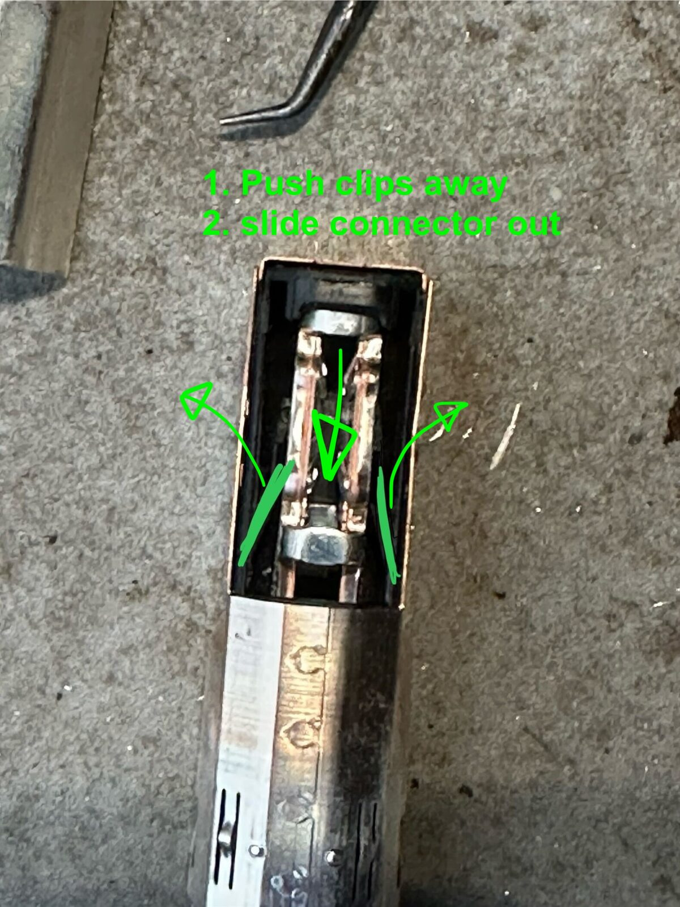{ width="200" }](../../images/bmw-i3-09.jpg)
[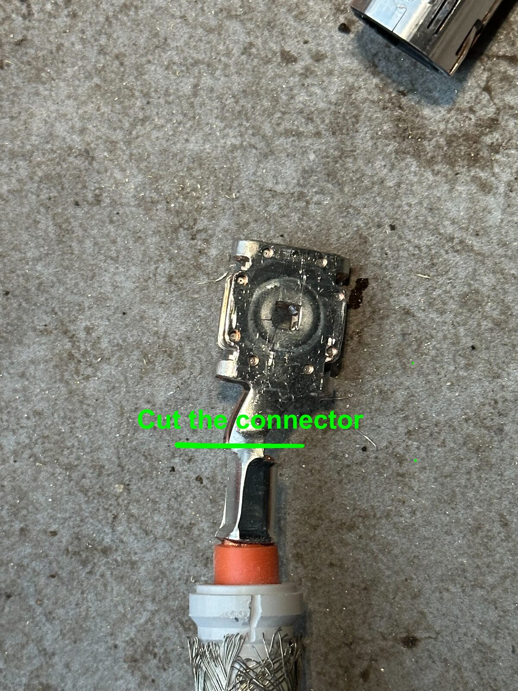{ width="200" }](../../images/bmw-i3-10.jpg)
[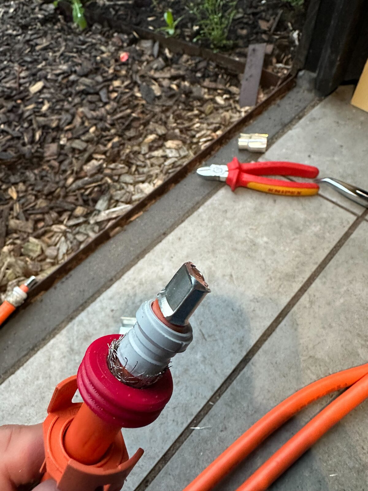{ width="200" }](../../images/bmw-i3-11.jpg)
[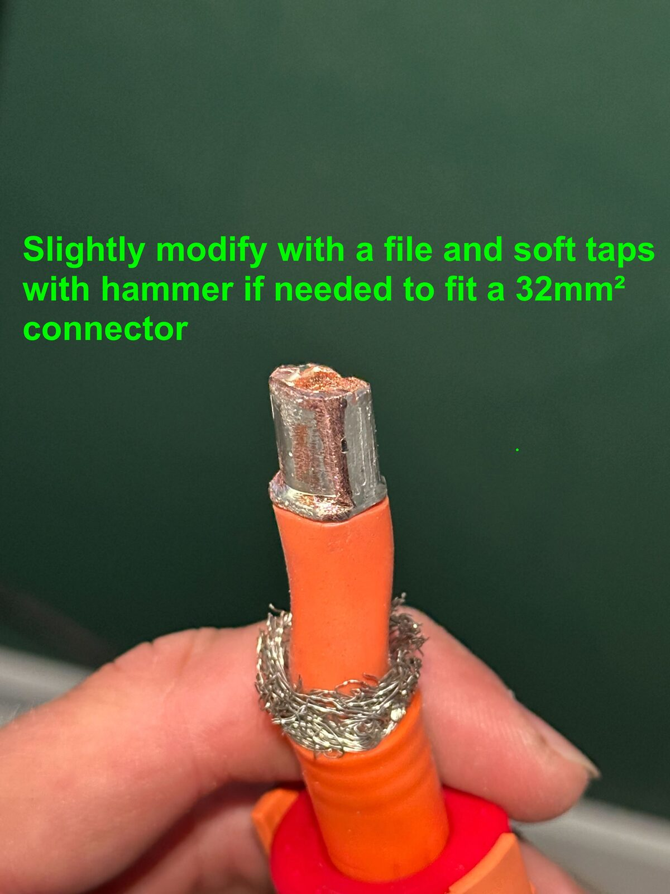{ width="200" }](../../images/bmw-i3-12.jpg)
[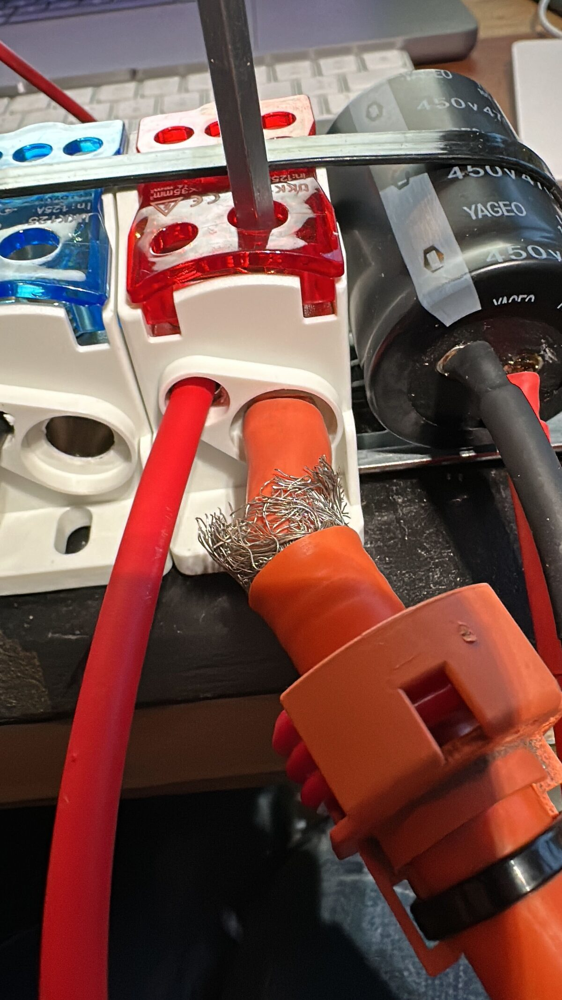{ width="200" height="267" }](../../images/bmw-i3-13.jpg)

